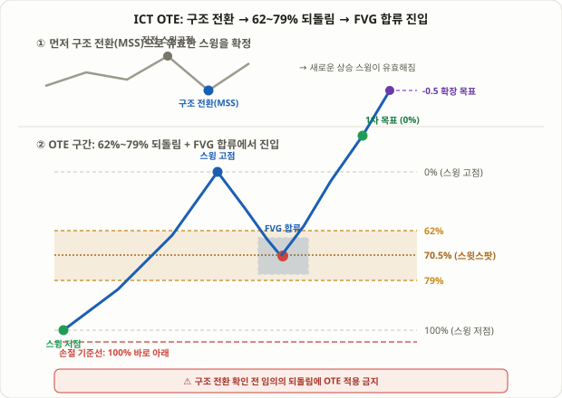

## OTE란: 피보나치 되돌림을 "어디서 들어가야 하는가"로 좁힌 ICT 개념

**OTE(Optimal Trade Entry, 최적 진입 구간)**는 ICT(Inner Circle Trader) 계열에서 쓰는 용어로, 30강 [피보나치 되돌림·확장](/strategies/fibonacci-retracement-extension/)에서 배운 일반적인 되돌림 도구를 "진입은 정확히 어느 구간에서 노려야 하는가"라는 질문으로 좁힌 버전입니다. 클래식 피보나치가 23.6%부터 78.6%까지 넓은 구간을 모두 유효한 되돌림 레벨로 취급하는 반면, OTE는 그중에서도 **62%~79% 구간**만을 "진입을 검토할 가치가 있는 구간"으로 한정합니다. 이 구간의 정가운데인 **70.5%(0.705)**를 흔히 "스윗스팟(sweet spot)"이라고 부릅니다.

중요한 전제가 하나 있습니다. OTE는 아무 되돌림에나 적용하는 도구가 아니라, 48강 [BOS와 CHoCH](/strategies/market-structure-bos-choch/)에서 다룬 **구조 전환이 먼저 확인된 다음**에만 그려야 하는 되돌림입니다. 즉 "스윙이 어디서 어디까지인지"를 구조적으로 확정한 뒤, 그 스윙의 되돌림 구간 안에서 재진입 자리를 찾는 2단계 도구입니다. 구조 전환 없이 임의의 두 지점에 OTE를 그리면, 애초에 "유효한 스윙"이 아닌 구간에 피보나치를 긋는 셈이 되어 의미가 없어집니다.

## 왜 62%~79% 구간인가: 심리와 메커니즘

클래식 피보나치의 골든존(38.2%~61.8%)과 OTE의 62%~79% 구간은 겹치는 부분이 있지만 완전히 같지는 않습니다. OTE가 이보다 더 깊은 되돌림 구간을 쓰는 이유로 다음과 같은 설명이 함께 거론됩니다.

- **얕은 되돌림은 추세 지속의 노이즈일 가능성이 높다**: 되돌림이 38%~50% 정도에서 끝난다면, 이는 단순한 숨고르기일 뿐 아직 "진짜 재진입 기회"로 보기 어려운 경우가 많습니다. 더 깊게 되돌아올수록, 직전 스윙에 물렸던 반대 방향 트레이더들의 손절과 추가 유동성이 함께 흔들려 나올 가능성이 커진다는 논리입니다.
- **61.8%를 살짝 넘는 구간에 미체결 주문이 몰린다는 관찰**: 많은 트레이더가 되돌림 매수·매도 주문을 61.8% 부근에 걸어두는데, 가격이 그 레벨을 살짝 무너뜨리고 지나가면서 그 주문들의 손절까지 함께 체결시키는 움직임이 반복적으로 관찰됩니다. OTE는 바로 이 "61.8% 너머"의 구간을 적극적으로 활용합니다.
- **79%(0.786)는 구조 자체가 무효화되는 경계에 가깝다**: 되돌림이 79%를 넘어 100%(스윙의 시작점)에 가까워지면, 이는 더 이상 "건강한 되돌림"이 아니라 추세 자체가 꺾였을 가능성을 의미합니다. 따라서 62%~79%는 "충분히 깊어서 유동성을 흡수했지만, 아직 구조가 무효화되지는 않은" 좁은 창을 겨냥한 구간입니다.

이 설명들은 모두 ICT/SMC 커뮤니티에서 공유되는 논리이며, 학계에서 통계적으로 검증된 인과관계는 아닙니다. 다만 "되돌림이 깊을수록 반대편 유동성을 더 많이 흡수한다"는 발상 자체는 유동성 스윕을 다루는 5강 [ICT 스마트머니 컨셉 기초](/strategies/ict-smart-money-basics/)의 논리와 일관됩니다.

<figure class="diagram">
  
  <figcaption>구조 전환으로 유효한 스윙을 먼저 확정한 뒤, 62%~79% OTE 구간과 FVG가 겹치는 자리에서 진입하고 스윙 시작점 바로 바깥에 손절을 둡니다.</figcaption>
</figure>

## 클래식 피보나치 되돌림 vs ICT OTE: 무엇이 다른가

두 도구는 같은 수학(피보나치 비율)을 쓰지만 적용 방식과 목적이 다릅니다.

| 구분 | 클래식 피보나치 되돌림 | ICT OTE |
|---|---|---|
| 선행 조건 | 특별히 없음 — 눈에 보이는 스윙에 바로 적용 | 구조 전환(MSS/CHoCH)으로 스윙 유효성을 먼저 확인 |
| 관심 구간 | 23.6%~78.6% 전체 | 62%~79%로 한정 (스윗스팟 70.5%) |
| 핵심 신뢰 레벨 | 38.2%~61.8% (골든존) | 61.8%~78.6% 사이 (OTE 존) |
| 추가 확인 | 선택적(캔들 패턴, 추세선 등) | FVG·오더블록 등 합류를 적극적으로 요구 |
| 무효화 기준 | 100%(스윙 시작점) 이탈 | 79%를 크게 벗어나거나 구조가 재차 깨질 때 |

실무적으로는 두 도구가 배타적이지 않습니다. 골든존에서 반응이 나오지 않고 가격이 더 깊이 밀리는 상황에서, OTE 구간은 "아직 추세가 살아있다고 볼 수 있는 마지노선"을 다시 한번 체크하는 2차 필터 역할을 합니다. 즉 OTE를 "더 엄격한 조건을 추가한 골든존의 하위 집합"으로 이해하면 두 개념의 관계가 명확해집니다.

## 실전 진입 로직: 구조 전환 → 스윙 지정 → OTE 되돌림 → 합류 확인

OTE를 실제 매매로 옮기는 과정은 다음 순서를 따릅니다.

1. **구조 전환 확인**: 현재 보고 있는 타임프레임(또는 상위 타임프레임)에서 BOS나 CHoCH로 새로운 추세 방향이 확정되어야 합니다. 이 단계 없이 임의의 되돌림에 OTE를 그리는 것은 권장되지 않습니다.
2. **유효한 스윙 지정**: 구조 전환을 만든 움직임의 시작점(스윙 저점 또는 고점)과 끝점(직전 스윙 고점 또는 저점)을 명확히 표시합니다. 상승 추세라면 스윙 저점이 100%, 스윙 고점이 0%가 됩니다.
3. **OTE 구간 그리기**: 62%, 70.5%, 79% 레벨을 표시하고, 가격이 이 구간으로 되돌아오기를 기다립니다. 되돌림이 62% 전에 멈추면 아직 OTE 진입 조건이 아니며, 79%를 넘어서면 구조가 흔들리고 있다는 경고로 받아들입니다.
4. **합류 확인**: 62%~79% 구간 안에 8강 [IFVG·PO3](/strategies/ifvg-po3-three-tiers/)에서 다룬 FVG(페어밸류갭)나 39강 [오더블록](/strategies/order-blocks/)이 겹쳐 있는지 확인합니다. 이 합류가 있을 때와 없을 때를 구분하는 것이 OTE 활용의 핵심이며, 합류 없이 구간 진입만으로 들어가는 것은 신뢰도가 낮은 접근으로 평가됩니다.
5. **진입 트리거와 손절**: 합류 지점에서 반응 캔들(심지가 길게 빠지며 반대 방향으로 마감하는 캔들 등)이 나오면 진입합니다. 손절은 100% 레벨(스윙 시작점) 바로 바깥에 둡니다. 되돌림이 79%를 넘어 100%에 근접하면 셋업은 무효로 간주합니다.
6. **목표가 설정**: 1차 목표는 0%(직전 스윙 고점/저점), 추세가 강하면 음(−)의 확장 구간인 −0.5, −1, −1.618 레벨까지 연장합니다. 이는 100%→0% 구간을 기준으로 0% 바깥쪽으로 같은 비율을 더 늘려 그리는 피보나치 확장과 같은 방식입니다.

## 숫자로 보는 실전 예시: MSFT 되돌림 매수

MSFT가 저점 405달러에서 고점 452달러까지 상승한 뒤(스윙 폭 47달러), 저시간대에서 하락 쪽 구조 전환이 나왔다가 다시 상승 쪽 구조 전환(CHoCH)으로 뒤집히며 새로운 상승 스윙이 유효해졌다고 가정합니다.

1. **스윙 지정**: 405달러를 100%(스윙 저점), 452달러를 0%(스윙 고점)로 피보나치를 긋습니다.
2. **OTE 레벨 계산**: 62% = 452 − 47×0.62 = 422.9달러, 70.5%(스윗스팟) = 452 − 47×0.705 = 418.9달러, 79% = 452 − 47×0.79 = 414.9달러.
3. **되돌림 관찰**: 가격이 429달러에서 423달러까지 밀리며 62% 레벨(422.9달러)을 살짝 지나 419.5달러까지 내려옵니다 — 스윗스팟 418.9달러 근처입니다.
4. **합류 확인**: 419~421달러 구간에 반등 당시 남은 FVG가 걸쳐 있는 것을 확인합니다.
5. **진입과 손절**: 420달러에서 긴 아래꼬리를 남긴 반응 캔들이 나와 419.8달러에 매수 진입. 손절은 100% 레벨(405달러) 바로 아래인 403달러(16.8달러 리스크).
6. **목표가**: 1차 목표 0%(452달러, 32.2달러 수익, 손익비 약 1.9:1), 확장 목표 −0.5 레벨(452 + 47×0.5 = 475.5달러, 손익비 약 3.3:1).

만약 3번 단계에서 가격이 79% 레벨인 414.9달러를 깨고 그대로 405달러의 스윙 저점까지 밀렸다면, 이는 OTE 되돌림이 아니라 상승 스윙 자체가 무효화되는 상황이므로 매수 진입은 보류해야 합니다.

## 자주 묻는 질문

### OTE와 골든존 중 어느 것을 먼저 봐야 하나요?
정해진 순서는 없습니다. 많은 트레이더가 38.2%~61.8% 골든존에서 먼저 반응을 확인하고, 반응이 없으면 되돌림이 더 깊어지는 것을 받아들이면서 62%~79% OTE 구간을 2차 관찰 지점으로 전환하는 방식을 씁니다. 둘 다 통계적으로 검증된 우선순위는 없으며, 어느 쪽을 기준으로 삼든 일관되게 적용하는 것이 더 중요합니다.

### 되돌림이 79%를 살짝 넘으면 바로 무효로 봐야 하나요?
자료마다 차이가 있습니다. 일부는 79%를 엄격한 상한으로 보고, 일부는 100%(스윙 시작점)에 근접하기 전까지는 여전히 유효한 되돌림으로 취급합니다. 중요한 것은 79%를 넘어서는 순간부터는 "건강한 되돌림"보다 "추세 무효화" 쪽 가능성이 함께 커진다는 점을 인식하고, 손절 기준을 명확히 정해두는 것입니다.

### 검증된 승률이나 통계가 있나요?
공신력 있는 기관의 독립 백테스트 결과는 확인되지 않았습니다. 인터넷에서 돌아다니는 특정 승률·손익비 수치는 지표·강의 판매 업체의 자체 마케팅 자료에서 나온 경우가 많아 그대로 신뢰하기 어렵습니다. 이 글의 숫자 예시 역시 개념 설명을 위한 가정일 뿐, 보장된 결과가 아닙니다.

## 한계와 유의점

- **주관적 스윙 지정**: 어디를 스윙 고점·저점으로 볼지는 트레이더마다 다를 수 있어, 같은 차트에서도 서로 다른 OTE 구간이 그려질 수 있습니다. 상위 타임프레임 구조부터 확인하는 습관이 이 오차를 줄여줍니다.
- **합류 없는 OTE는 근거가 약하다**: 단순히 "62~79% 구간에 들어왔다"는 사실만으로 진입하면, 가격이 얼마든지 그 구간을 그대로 통과해 79%를 넘길 수 있습니다. FVG·오더블록 같은 추가 합류 없이 구간 진입만 믿는 것은 권장되지 않습니다.
- **학계 검증이 없는 경험칙**: OTE 역시 ICT/SMC 계열 전반과 마찬가지로 커뮤니티 관찰에 기반한 프레임워크이며, 통계적으로 입증된 우위라는 근거는 없습니다.
- **추세 강도에 따라 되돌림 폭 자체가 달라진다**: 매우 강한 추세에서는 되돌림이 38%~50%에서 끝나버려 OTE 구간까지 오지 않는 경우도 흔합니다. OTE 구간만 기다리다가 얕은 되돌림으로 끝나는 움직임을 놓칠 수 있다는 점도 감안해야 합니다.
- **뉴스·실적 발표와의 충돌**: 중요 지표나 실적 발표를 앞두고는 되돌림의 깊이와 방향이 왜곡될 수 있어, OTE 구간 진입의 신뢰도가 평소보다 떨어질 수 있습니다.

## 정리

- OTE(Optimal Trade Entry)는 ICT 계열에서 쓰는 개념으로, 클래식 피보나치 되돌림 중에서도 **62%~79%(스윗스팟 70.5%) 구간**만을 재진입 검토 대상으로 좁힌 도구입니다.
- 반드시 구조 전환(BOS/CHoCH)으로 유효한 스윙을 먼저 확정한 뒤에 그려야 하며, 임의의 두 지점에 바로 적용하는 것은 권장되지 않습니다.
- 진입 신뢰도는 FVG나 오더블록 같은 합류가 OTE 구간 안에 겹치는지에 크게 좌우되며, 합류 없는 단순 구간 진입은 근거가 약한 접근으로 평가됩니다.
- 손절은 스윙 시작점(100% 레벨) 바로 바깥에, 목표가는 직전 스윙(0%)과 그 너머의 음(−) 확장 구간에 설정하는 것이 일반적인 틀입니다.
- 검증된 승률·손익비 통계는 존재하지 않으므로, 제시된 숫자는 모두 개념 설명용 예시로 받아들이고 독립적인 자금관리 규칙을 함께 적용해야 합니다.
