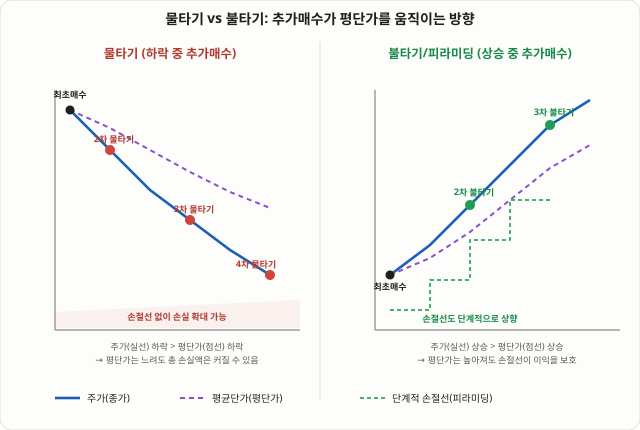

## 물타기와 불타기, 정확히 무엇을 가리키는 말인가

주식 커뮤니티에서 가장 자주 등장하는 두 단어를 고르면 "물타기"와 "불타기"일 것입니다. **물타기**는 보유 종목의 가격이 떨어졌을 때 추가로 매수해 평균 매입단가(평단가)를 낮추는 행위입니다. **불타기**는 그 반대로, 가격이 오르고 있는 보유 종목에 추가로 매수해 포지션 규모를 키우는 행위를 가리킵니다. 영어권에서는 전자를 averaging down, 후자를 보통 pyramiding(피라미딩) 또는 adding to winners라고 부릅니다.

두 단어 모두 "추가매수"라는 같은 행동을 하지만, 방향이 정반대이기 때문에 평단가에 미치는 영향도, 전략으로서의 성격도 완전히 다릅니다. 이 둘을 같은 범주로 묶어서 "어느 쪽이 맞느냐"로 접근하면 핵심을 놓치기 쉽습니다. 둘은 애초에 서로 다른 전제 위에서 작동하는 기법이고, 각각 나름의 논리와 함정을 갖고 있습니다. [6강 손익비와 자금관리](/strategies/risk-reward-money-management/)에서 손절·목표가를 미리 정하는 원칙을 다뤘다면, 이번 글은 "그 원칙을 지킨 채로 추가매수를 어떻게 다뤄야 하는가"를 다루는 글입니다.

## 평단가는 어떻게 움직이는가: 계산으로 먼저 확인하기

평단가 계산 공식은 단순합니다.

```
평단가 = (1차 매수금액 + 2차 매수금액 + ...) / (1차 매수수량 + 2차 매수수량 + ...)
```

예를 들어 10,000원에 10주, 12,000원에 20주를 샀다면 평단가는 (100,000 + 240,000) / 30 = 11,333원입니다. 이 단순한 산술이 물타기와 불타기의 심리를 가르는 지점입니다. 물타기는 "싼 가격에 더 산다"는 행위이므로 평단가가 항상 기존 가격보다 낮아지는 방향으로 움직이고, 불타기는 "비싼 가격에 더 산다"는 행위이므로 평단가가 항상 기존 가격보다 높아지는 방향으로 움직입니다.

여기서 반드시 짚어야 할 오해가 하나 있습니다. **평단가가 낮아진다고 손실이 줄어드는 것이 아닙니다.** 평단가는 "본전을 회복하는 데 필요한 주가 수준"을 낮춰줄 뿐, 계좌에 묶인 절대 손실 금액이나 투입 자본의 크기는 오히려 늘어납니다. 반대로 불타기에서 평단가가 올라간다는 것은 "이익을 지키기 위해 필요한 주가 수준"이 높아진다는 뜻이지만, 동시에 포지션 전체가 가격 변동에 더 크게 노출된다는 뜻이기도 합니다. 두 기법 모두 평단가라는 숫자 하나만 보고 판단하면 실제 리스크 변화를 놓치기 쉽습니다.

<figure class="diagram">
  
  <figcaption>물타기는 평단가가 주가보다 느리게 내려가지만 손절 기준이 없으면 손실이 계속 커질 수 있고, 불타기는 평단가가 함께 올라가는 대신 손절선을 단계적으로 끌어올려 이익을 지킬 수 있다.</figcaption>
</figure>

## 왜 이런 행동을 하게 되는가: 손실회피와 처분효과

두 행동 모두 수학이 아니라 심리에서 출발하는 경우가 많습니다. 행동경제학에서 자주 인용되는 **손실회피(loss aversion)**는 사람이 같은 크기의 손실을 이익보다 심리적으로 훨씬 더 크게 느낀다는 경향을 가리킵니다. 평가손실이 난 종목을 "손실 확정"하고 매도하는 대신, 추가매수로 평단가를 낮춰 "다시 본전 근처로 보이게" 만들고 싶은 유혹이 여기서 생깁니다. 이는 **처분효과(disposition effect)** — 이익 난 종목은 서둘러 팔고 손실 난 종목은 질질 끌고 가는 경향 — 과도 연결됩니다. 물타기는 이 처분효과를 "매도를 미루는 것"에서 "추가매수로 적극적으로 버티는 것"으로 한 단계 더 끌고 간 행동이라고 볼 수 있습니다.

불타기의 심리적 뿌리는 조금 다릅니다. 가격이 오르고 있다는 사실 자체가 "내 판단이 맞았다"는 확인처럼 느껴지고, 이 확신이 추가매수로 이어집니다. 문제는 이 확신이 **실제로 추세가 확인된 신호(예: 신고가 돌파, 거래량 증가)**에 근거한 것인지, 아니면 단순히 "오르고 있으니까 더 사고 싶다"는 흥분(excitement)에 근거한 것인지 구분하기 쉽지 않다는 점입니다. 트레이딩 교육 자료들은 공통적으로 이 구분을 강조합니다 — 계획된 조건을 만족해서 추가매수하는 것과, 오르는 것을 보고 충동적으로 추가매수하는 것은 겉모습은 같아도 완전히 다른 행동입니다.

## 비교표: 물타기 vs 불타기

| 구분 | 물타기 (Averaging Down) | 불타기/피라미딩 (Pyramiding) |
|---|---|---|
| 추가매수 시점 | 가격이 떨어졌을 때 | 가격이 올랐을 때(대개 신고가 갱신 등 확인 신호 이후) |
| 평단가 방향 | 낮아진다 | 높아진다 |
| 포지션 전체 리스크 | 투입 자본이 늘어나며 커진다 | 수익 구간에서 커지지만, 원금 손실 위험은 상대적으로 제한적 |
| 전형적인 함정 | '물귀신' — 하락에 베팅을 계속 늘리는 것 | '추격매수' — 흥분 때문에 비계획적으로 늘리는 것 |
| 손절 기준 설계 | 처음 진입 시점 손절가를 반드시 고정해둬야 함 | 새 매수마다 손절선을 함께 끌어올리는 것이 일반적 |
| 대표적으로 연관되는 접근 | 밸류에이션 기반 분할매수, 장기투자 관점의 추가매수 | [터틀 트레이딩](/strategies/breakout-donchian-orb/), [다바스 박스](/strategies/darvas-box-strategy/) 등 추세추종 돌파매매 |
| 자금관리와의 관계 | [켈리 공식](/strategies/kelly-criterion-position-sizing/) 기준 1회 리스크 한도를 넘기기 쉬움 | 트랜치마다 리스크를 재계산하면 비교적 통제 가능 |

이 표에서 가장 중요한 줄은 "대표적으로 연관되는 접근"입니다. 불타기(피라미딩)는 터틀 트레이딩이나 다바스 박스처럼 **추세가 이미 확인된 뒤에만 추가매수를 허용하는 체계적인 규칙**과 짝을 이루는 경우가 많습니다. 반면 물타기는 "지금 싸졌으니 더 사자"는 단순한 심리적 반응으로 끝나는 경우가 많고, 이를 체계적인 전략으로 만들려면 밸류에이션이나 사전에 정해둔 트랜치 계획처럼 별도의 근거가 필요합니다.

## 숫자로 보는 두 가지 시나리오

아래 예시는 개념 이해를 위한 단순화된 가상 사례이며, 실제 검증된 거래 기록이 아닙니다.

### 시나리오 A: 물타기 — 평단가는 낮아지지만 손실 규모는 커진다

| 단계 | 매수가 | 매수수량 | 투입금액 | 평단가 |
|---|---|---|---|---|
| 1차 | 10,000원 | 10주 | 100,000원 | 10,000원 |
| 2차(물타기) | 8,000원 | 10주 | 80,000원 | 9,000원 |
| 3차(물타기) | 6,500원 | 15주 | 97,500원 | 7,857원 |

3차 매수 이후 현재가가 6,500원이라면, 평단가(7,857원) 대비 평가손실률은 약 -17.3%입니다. 만약 물타기를 하지 않고 1차 매수만 10,000원에 10주 보유했다면 같은 가격(6,500원)에서 평가손실률은 -35%입니다. **숫자만 보면 물타기가 손실률을 거의 절반으로 줄인 것처럼 보이지만**, 실제 평가손실 금액은 1차만 보유했을 때의 -35,000원보다 3차까지 물탄 경우 -48,278원으로 오히려 더 큽니다. 투입 자본이 100,000원에서 277,500원으로 거의 3배 늘었기 때문입니다. 이것이 "평단가는 낮아져도 손실 규모는 커질 수 있다"는 말의 정확한 의미입니다.

### 시나리오 B: 불타기(피라미딩) — 평단가는 높아지지만 손절선이 함께 올라간다

| 단계 | 매수가 | 매수수량 | 투입금액 | 평단가 | 손절선 |
|---|---|---|---|---|---|
| 1차 | 10,000원 | 20주 | 200,000원 | 10,000원 | 9,200원 (직전 저점) |
| 2차(피라미딩) | 11,500원 | 10주 | 115,000원 | 10,500원 | 10,800원 (새 저점) |
| 3차(피라미딩) | 13,000원 | 10주 | 130,000원 | 11,125원 | 12,200원 (새 저점) |

현재가가 13,500원까지 올랐다면 평단가(11,125원) 기준 수익률은 약 +21.3%입니다. 여기서 핵심은 손절선이 9,200원 → 10,800원 → 12,200원으로 단계적으로 끌어올려졌다는 점입니다. 만약 추세가 꺾여 손절선(12,200원)에서 전체 포지션이 청산되더라도, 전체 평단가(11,125원) 대비로는 여전히 소액의 이익(약 +9.7%)이 남습니다. 즉 체계적으로 설계된 불타기는 "추가매수를 할수록 손절 기준도 함께 보수적으로 바뀌어, 추세가 꺾였을 때 그동안 쌓은 이익의 상당 부분을 지킬 수 있는 구조"를 만들 수 있습니다. 이는 [74강 다바스 박스](/strategies/darvas-box-strategy/)에서 다룬 "상자를 쌓으며 손절을 함께 끌어올리는" 피라미딩 구조와 정확히 같은 원리입니다.

## 물타기가 전략이 되는 조건과 '물귀신'이 되는 순간

물타기 자체가 무조건 나쁜 것은 아닙니다. 옵션 전략가 로렌스 맥밀런(Lawrence McMillan) 같은 실무자들도 "전반적으로 상승 추세인 종목이 일시적으로 되돌림(pullback)을 보일 때의 추가매수"와 "그냥 하락하는 종목을 가격이 싸다는 이유만으로 계속 사들이는 것"을 분명히 구분해야 한다고 지적합니다. 물타기가 전략으로 성립하려면 보통 다음 조건이 필요합니다.

- **사전에 정해둔 트랜치 계획**: "처음부터 자금의 30%만 1차로 투입하고, 특정 가격대까지 하락하면 2차·3차를 투입한다"는 계획이 매수 이전에 이미 서 있어야 합니다. 떨어지는 걸 보고 그때마다 즉흥적으로 결정하는 것과는 다릅니다.
- **하락의 이유에 대한 판단**: 전체 시장이 함께 빠지는 상황인지, 그 종목만의 악재(실적 쇼크, 펀더멘털 훼손)인지 구분해야 합니다. 후자라면 추가매수의 전제 자체가 무너진 것입니다.
- **총 투입 한도의 고정**: 몇 차까지 물타기를 할지, 총 투입 금액의 상한을 얼마로 둘지를 미리 정해둬야 합니다. 이 한도가 없으면 "조금만 더 사면 평단가가 맞춰진다"는 생각으로 계속 추가매수를 하다가 계좌 전체가 한 종목에 묶이는 상황("물귀신")에 빠지기 쉽습니다.

이 조건들이 없는 물타기는 사실상 손실을 확정하고 매도하는 결정을 계속 미루는 행위에 가깝습니다. 뉴스 기사에서도 물타기 이후 오히려 전체 수익률이 더 악화된 사례가 자주 보고되는데, 이는 투입 자본이 늘어나면서 절대적인 손실 금액이 커지는 구조 때문입니다.

## 불타기가 전략이 되는 조건과 '추격매수'가 되는 순간

불타기도 마찬가지로 조건 없이 쓰면 위험합니다. 가장 흔한 실패 패턴은 가격이 오르는 것을 보고 흥분해서, 아무 확인 신호 없이 그냥 더 사는 것입니다. 체계적인 불타기(피라미딩)는 보통 다음을 전제로 합니다.

- **추세가 확인된 이후에만 추가매수**: [11강 돈치안 채널·터틀 트레이딩](/strategies/breakout-donchian-orb/)이나 다바스 박스처럼, "새로운 신고가를 만들었다"거나 "직전 저항을 거래량과 함께 돌파했다" 같은 명확한 기준을 통과한 뒤에만 추가매수합니다.
- **손절선을 반드시 함께 올리기**: 추가매수를 할 때마다 전체 포지션의 손절선을 더 높은 지점으로 끌어올립니다. 이것이 없으면 불타기는 그냥 "비싸게 더 산 포지션"이 되어, 추세가 꺾였을 때 오히려 손실이 커지는 구조가 됩니다.
- **추가매수 단위를 줄여가기**: 1차보다 2차, 2차보다 3차의 매수 규모를 점점 줄이는 것이 일반적인 관행입니다. 추세가 이미 진행된 만큼 리스크도 커지기 때문에, 포지션을 키우되 새로 추가하는 단위는 작게 유지하는 셈입니다.

터틀 트레이더들이 돈치안 채널 돌파마다 기계적으로 추가매수하면서도 손절선을 매일 자동으로 재조정했던 것은 바로 이 "확인 + 손절 동반 상향"이라는 두 조건을 규칙으로 고정해둔 사례입니다.

## 실전 규칙: 사전에 트랜치를 정해두는 법

물타기와 불타기 모두 즉흥적인 판단이 아니라 사전 계획으로 다뤄야 한다는 결론은 같습니다. 실전에서 참고할 수 있는 체크리스트는 다음과 같습니다.

1. **1차 매수 전에 전체 계획을 수량화합니다.** 몇 차까지 추가매수할지, 각 트랜치의 가격 조건과 투입 비중을 매수 전에 숫자로 적어둡니다.
2. **방향과 무관하게 총 리스크 한도를 지킵니다.** [켈리 공식](/strategies/kelly-criterion-position-sizing/)이나 [6강의 R 멀티플](/strategies/risk-reward-money-management/) 기준으로 한 종목에 걸리는 총 리스크가 계좌의 일정 비율을 넘지 않도록 상한을 둡니다. 물타기든 불타기든, 트랜치가 쌓일수록 이 한도에 더 쉽게 가까워집니다.
3. **물타기는 "왜 떨어졌는가"에 답할 수 있어야 진행합니다.** 답이 "그냥 쌌으니까"라면 멈추는 것이 안전합니다.
4. **불타기는 추가매수마다 손절선을 반드시 재조정합니다.** 손절선을 올리지 않는 불타기는 그냥 고점에서 물량을 늘린 것과 같습니다.
5. **감정이 아니라 기록으로 복기합니다.** 추가매수 결정을 내릴 때마다 그 근거를 적어두면, 나중에 "계획대로 한 것"과 "흥분해서 한 것"을 구분할 수 있습니다.

## 자주 묻는 질문

### 물타기를 하면 안 되나요?
무조건 안 된다는 뜻은 아닙니다. 다만 "가격이 쌌으니까"라는 이유만으로 하는 물타기는 위험합니다. 사전에 정한 트랜치 계획과 총 투입 한도가 있고, 하락의 원인이 종목 자체의 펀더멘털 훼손이 아니라고 판단될 때에만 제한적으로 고려할 만한 접근입니다.

### 불타기와 분할매수(DCA)는 같은 건가요?
다릅니다. 분할매수(Dollar-Cost Averaging)는 가격과 무관하게 정해진 주기로 일정 금액을 기계적으로 매수하는 방식이고, 불타기(피라미딩)는 가격이 오르고 추세가 확인됐다는 조건이 충족될 때만 추가매수하는 방식입니다. 분할매수는 규칙 기반, 불타기는 신호 기반이라는 점이 가장 큰 차이입니다.

### 둘 중 어느 쪽이 더 안전한가요?
우열의 문제로 단정하기는 어렵습니다. 다만 구조적으로, 불타기는 추세 확인과 손절 상향이라는 규칙을 동반하면 손실을 제한하기가 비교적 쉽고, 물타기는 하락이 계속될 경우 손실 한도를 별도로 강하게 설계해두지 않으면 투입 자본과 함께 손실이 함께 커지는 구조라는 차이는 분명합니다.

## 정리

- 물타기는 가격 하락 시 추가매수로 평단가를 낮추는 행위, 불타기(피라미딩)는 가격 상승 시 추가매수로 포지션을 키우는 행위로, 평단가가 움직이는 방향이 정반대입니다.
- 평단가가 낮아진다고 손실 규모가 줄어드는 것은 아니며, 투입 자본이 늘어나면서 절대 손실액은 오히려 커질 수 있습니다 — 반대로 평단가가 높아져도 손절선을 함께 올리면 이익을 지킬 수 있습니다.
- 두 행동 모두 손실회피·처분효과 같은 심리적 동기에서 출발하는 경우가 많으며, 이를 전략으로 바꾸려면 사전에 정한 트랜치 계획과 손절 기준이 반드시 필요합니다.
- 체계적인 불타기는 추세 확인 + 손절 동반 상향이라는 규칙과 짝을 이루는 경우가 많고(터틀 트레이딩, 다바스 박스), 물타기는 밸류에이션 근거와 총 투입 한도 없이는 '물귀신'이 되기 쉽습니다.
- 실전에서는 방향과 무관하게 1차 매수 전에 전체 트랜치 계획과 총 리스크 한도를 숫자로 정해두고, 그 계획을 기록으로 복기하는 것이 두 기법 모두를 안전하게 쓰는 공통된 전제입니다.
