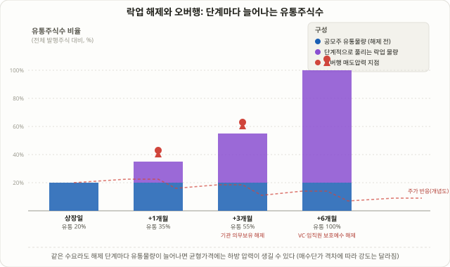

## 오버행이란 무엇인가: 락업과 의무보유확약의 차이

신규상장 종목을 다루다 보면 "오버행(overhang)"이라는 단어를 자주 만나게 됩니다. 오버행은 지금 당장 시장에 나온 물량이 아니라, **보유자가 마음만 먹으면 언제든 시장에 내놓을 수 있는 잠재 매도 물량**을 가리킵니다. 이 물량이 왜, 언제 풀리는지를 이해하는 것이 이번 강의의 핵심입니다.

오버행이 생기는 가장 큰 통로가 바로 **락업(lock-up)**, 한국식으로는 **보호예수**와 **의무보유확약**입니다. 둘은 법적으로 성격이 다릅니다. 보호예수는 상장 전 투자한 벤처캐피탈(VC)·사모펀드(FI) 등이 상장 후 일정 기간 지분을 팔지 않기로 거래소 규정이나 계약으로 묶어두는 것이고, 의무보유확약은 공모주를 배정받은 기관투자자가 "이 물량을 일정 기간 팔지 않겠다"고 자발적으로 약속하는 제도입니다. 미국에서는 이 둘을 구분하지 않고 보통 주관사와 상장 전 주주 사이의 계약인 **락업 기간**으로 통칭하며, 관행적으로 90일·180일(약 6개월)이 가장 흔하고 경우에 따라 단계적으로 풀리는 구조도 있습니다. 한국에서는 기관 의무보유확약 기간이 보통 15일·1개월·3개월·6개월 중 몇 가지가 섞여 단계적으로 설정되는 경우가 많습니다. 확약을 어기고 팔면 제재가 따르는데, 위반 금액에 따라 최소 6개월에서 1년까지 모든 공모주 수요예측 참가가 금지될 수 있다는 점도 함께 알아둘 필요가 있습니다.

여기서 중요한 구분이 하나 더 있습니다. 108강에서 다룬 [자사주 매입 블랙아웃](/strategies/buyback-blackout-window/)은 "매수자가 사라지는" 수급 공백이었지만, 이번 주제는 정확히 반대입니다. 락업·의무보유확약 해제는 **매도할 수 있는 사람이 갑자기 늘어나는** 사건입니다. 두 강의 모두 "공시된 날짜 없이 추정해야 하는 수급 이벤트"라는 공통점을 가지지만, 작동 방향은 거울처럼 반대입니다.

## 왜 매도 압력이 생기는가: 유통주식수 충격과 평균 매수단가 격차

락업이 풀리는 순간 가격이 흔들릴 수 있다는 논리는 두 가지 메커니즘에서 나옵니다.

첫째는 **유통주식수(float)의 급격한 증가**입니다. 상장 직후에는 공모에 참여한 일반 투자자들이 들고 있는 물량만 실제로 거래 가능하고, VC·FI·임직원·기관확약 물량은 "존재하지만 팔 수 없는" 상태로 묶여 있습니다. 락업이 한 번에 혹은 단계적으로 풀리면, 매도 가능한 주식의 절대량 자체가 늘어납니다. 같은 수요라도 공급이 갑자기 늘어나면 균형가격은 내려갈 수밖에 없다는, 수요-공급의 가장 단순한 원리가 여기에 그대로 적용됩니다.

둘째는 **매수 단가의 격차**입니다. 락업에 묶인 물량은 대부분 VC·FI가 공모가보다 훨씬 낮은 가격에, 혹은 공모 참여 기관이 공모가 그대로 취득한 주식입니다. 상장 후 주가가 공모가보다 많이 올라 있다면, 이들에게는 "지금 팔아도 충분히 남는" 상황이 만들어집니다. 반대로 주가가 공모가 아래로 내려와 있다면 매도 유인이 약해질 수도 있습니다. 즉 오버행 리스크의 크기는 단순히 "락업이 풀리느냐"가 아니라 **현재가가 보유자의 평균 매수단가 대비 얼마나 높은가**에 따라 달라진다는 점이 핵심입니다.

<figure class="diagram">
  
  <figcaption>상장 초기에는 유통주식수가 공모주 물량으로 제한되지만, 1개월·3개월·6개월 단위로 의무보유확약·락업이 풀릴 때마다 매도 가능 물량이 단계적으로 늘어나며 오버행 매도압력이 반복해서 나타날 수 있다.</figcaption>
</figure>

## 실제로 주가가 떨어지는가: 해외 연구와 국내 사례

"락업이 풀리면 무조건 떨어진다"고 단정하기 전에, 실제 연구 결과들을 나열해 보면 결론이 생각보다 더 엇갈린다는 것을 알 수 있습니다.

| 연구/사례 | 주요 내용 |
|---|---|
| Ofek & Richardson (초기 연구, 브라질 문헌 재인용) | 락업 해제 시점에 약 3%의 가격 하락과 거래량 40% 증가를 보고 |
| 북유럽 IPO 141건 연구 (2009~2017) | 해제 시점 전후 누적초과수익률(CAR) 평균 -1.1% |
| 미국 2000~2020년 연구 | 해제일 당일에는 통계적으로 유의한 하락이 없었지만, 해제 며칠 전부터 누적초과수익률 -0.94%의 선행 하락이 나타났고, 이 효과는 호가 스프레드가 좁은(거래가 활발한) 종목일수록 약해짐 |
| 같은 연구의 효율적시장 비판 | 해제일은 상장할 때부터 이미 알려진 일정이므로, 이론적으로는 가격에 선반영되어 있어야 한다는 반론 |
| 일부 연구 (락업 180일 초과 종목) | 오히려 해제 시점에 양(+)의 초과수익률을 보였다는 상반된 결과도 존재 |

이 표에서 가장 눈에 띄는 것은, 다수 연구가 "방향은 하락 쪽"이라는 데 어느 정도 동의하면서도 **그 하락이 해제 당일에 터지는지, 그 전에 미리 반영되는지, 크기가 얼마인지에 대해서는 결론이 갈린다**는 점입니다. 효율적시장 반론처럼 "이미 알려진 일정이니 선반영되어야 한다"는 논리도 무시할 수 없습니다. 따라서 이 주제는 **"검증된 통계적 엣지"가 아니라 "방향성에 대한 합리적 가설"**로 다뤄야 합니다.

해외 실제 사례로는 2022년 리비안(Rivian)이 락업 해제 시점을 전후해 주가가 약 21% 하락했다는 보도가 있었고, 반대로 쉐이크쉑(Shake Shack)은 락업 해제 이후 오히려 주가가 오르며 공매도 세력이 손실을 본 사례도 있었습니다. 트위터(현 X)는 2014년 5월 락업 해제를 앞두고 공매도 대차 비용이 연 30%까지 치솟았다는 기록도 있습니다. 즉 "해제 = 하락"이라는 단순한 공식은 개별 사례만 보면 쉽게 반증됩니다.

국내 사례를 보면 이 리스크가 특히 체감되는 구간이 있습니다. 2025년 5월 상장한 달바글로벌은 공모가 6만6300원에서 한때 24만1000원까지 오르며 공모가 대비 263% 넘게 상승했지만, 의무보유확약이 끝나자 기관들의 차익실현 매물이 쏟아지며 주가에 부담을 줬다는 보도가 나왔습니다. 알지노믹스는 전체 주식의 24%에 해당하는 락업 물량이 풀리며 "오버행 주의보"가 거론됐고, 대진첨단소재는 2025년 4월 FI 물량 약 159만주의 보호예수가 풀렸는데 상장 전 투자한 FI가 20곳을 넘고 이들의 지분율만 합쳐 49%에 달해 잠재 매도 물량 부담이 크다는 분석이 나왔습니다. 2026년 1월 보도에 따르면 리브스메드는 기관 의무보유확약 비율이 17.12%에 그쳐, 관련 제도 도입 이후 역대 최저 수준을 기록했습니다. 2025년 7월 금융당국은 기관 배정 물량 중 일정 비율 이상을 의무보유확약 기관에 우선 배정하도록 제도를 손질했는데, 이후 확약 비율이 전반적으로 높아지면서 상장 직후 유통주식수가 줄어 일부 종목의 초기 급등이 더 커졌다는 분석도 있었습니다. 이는 "확약 비율이 높을수록 상장 초기는 안정적이지만, 나중에 풀릴 물량의 절대량은 그대로 남는다"는 역설을 보여주는 사례이기도 합니다.

## 기법 A — 해제 캘린더 기반 리스크 관리

방향을 맞히려 하지 않고, 오버행 리스크가 커지는 구간 자체의 노출을 줄이는 접근입니다. 대부분의 개인 투자자에게 더 현실적인 기본값입니다.

1. **해제 일정을 직접 확인합니다.** 한국은 전자공시시스템(DART)의 증권발행실적보고서·지분공시에서 의무보유확약 비율과 해제일을 확인할 수 있고, 미국은 S-1·424B4 등록신고서의 락업 조항(통상 180일, 조기 해제 조건 포함)을 참고할 수 있습니다.
2. **해제되는 물량이 전체 유통주식수의 몇 %인지 계산합니다.** 10% 미만이라면 영향이 제한적일 수 있지만, 대진첨단소재 사례처럼 FI 지분이 전체의 40~50%에 달하면 리스크를 훨씬 보수적으로 봐야 합니다.
3. **현재가와 보호예수 물량의 평균 매수단가를 비교합니다.** 현재가가 공모가·VC 매입가보다 훨씬 높다면 매도 유인이 크고, 반대라면 유인이 약할 수 있습니다.
4. **06강 [손익비와 자금관리](/strategies/risk-reward-money-management/) 원칙에 맞춰 해제 구간을 앞두고 포지션을 줄이거나, 해제 이후 며칠간 신규 진입을 보류합니다.** 103강 [스핀오프 투자법](/strategies/spin-off-investing-forced-selling/)에서 다룬 강제매도 구간과 마찬가지로, 이 구간은 방향성 베팅보다 노출 관리가 우선입니다.

## 기법 B — 풋옵션·칼라로 보유 포지션 헤지하기

이미 해당 종목을 보유하고 있고, 해제 전에 매도하고 싶지 않은 투자자를 위한 접근입니다. 핵심은 하락 리스크를 없애거나 줄이면서도 보유 자체는 유지하는 것입니다.

1. **해제일 이후 만기가 오는 풋옵션을 매수합니다.** 하락 시 손실을 특정 가격 아래로 제한하는 보험 성격의 비용을 지불하는 것입니다. 알리바바의 사례처럼 락업 해제를 앞두고 풋옵션 미결제약정이 콜옵션보다 빠르게 늘어나는 현상이 관측된 적도 있습니다.
2. **비용이 부담스럽다면 82강 [칼라(Collar) 전략](/strategies/collar-strategy-protective-hedge/)을 고려합니다.** 풋옵션을 사면서 동시에 콜옵션을 팔아 헤지 비용을 낮추는 대신, 상승 수익의 상단을 포기하는 구조입니다.
3. **옵션 시장이 없거나 유동성이 낮은 종목이라면, 비중을 미리 줄이는 것 외에 현실적인 헤지 수단이 없다는 점을 인정해야 합니다.** 특히 한국의 중소형 신규상장주는 대부분 이 경우에 해당합니다.
4. **해제 이후 공매도 대차 비용이 급등하는지 관찰합니다.** 대차 비용이 치솟는다는 것은 이미 다른 투자자들도 같은 리스크를 인식하고 있다는 신호일 수 있지만, 동시에 공매도 자체가 비싸져서 숏 진입의 실익이 줄어든다는 뜻이기도 합니다.

## 기법 A vs 기법 B 비교

| 구분 | 기법 A: 노출 축소 | 기법 B: 옵션 헤지 |
|---|---|---|
| 목적 | 해제 구간 리스크 자체를 피함 | 보유를 유지하면서 하락 리스크만 제거 |
| 필요 조건 | 해제 일정, 유통주식수 비중 확인 | 해당 종목에 유동성 있는 옵션시장 존재 |
| 비용 | 기회비용(보유 유지 시 상승을 놓칠 수 있음) | 옵션 프리미엄(명시적 현금 비용) |
| 적합한 투자자 | 대부분의 개인·스윙 투자자 | 포지션을 반드시 유지해야 하는 중장기 보유자 |
| 한국 중소형 신규상장주 적용성 | 높음 | 낮음 (옵션 자체가 없는 경우가 많음) |
| 방향성 예측 필요 여부 | 불필요 | 불필요(보험 성격) |

두 기법 모두 "해제 시점의 가격 영향은 통계적으로 확정되지 않았지만, 유통주식수와 매수단가 격차라는 구조적 메커니즘은 실재한다"는 전제를 공유합니다. 기법 A는 그 불확실성을 노출을 줄여서 다루고, 기법 B는 보유를 유지하면서 보험을 사는 쪽입니다.

## 숫자로 보는 예시 (교육용 단순화 사례)

실제 종목의 데이터가 아니라, 메커니즘을 숫자로 이해하기 위한 가상의 단순화 사례입니다.

가상의 신규상장주 XYZ가 공모가 1만원으로 상장해 현재가 3만원(공모가 대비 200% 상승)에 거래되고 있다고 가정합니다. 상장 당시 유통주식수는 전체의 20%(200만주)였고, 3개월 의무보유확약이 걸린 기관 물량이 전체의 30%(300만주), 나머지 50%는 6개월 보호예수가 걸린 VC·임직원 물량이라고 가정합니다. 3개월 시점에 300만주가 풀리면 유통주식수는 200만주에서 500만주로 단숨에 150% 늘어납니다. 이 기관 물량의 평균 매수단가가 공모가와 같은 1만원이라면, 현재가 3만원에서는 이들에게 3배의 차익이 생기는 셈이라 매도 유인이 매우 크다고 볼 수 있습니다. 반대로 6개월 시점에 풀리는 VC 물량의 매수단가가 상장 전 투자 라운드 기준 3000원이었다면, 이들의 차익은 10배에 달해 매도 유인이 훨씬 더 큽니다. 이 예시는 실제 수치가 아니라, 해제 시점마다 "유통주식수 증가율"과 "보유자별 매수단가 격차"를 따로 계산해야 하는 이유를 보여주기 위한 가상의 교육용 사례입니다.

## 한계와 함정

- **해제가 하락을 보장하지 않는다**: 쉐이크쉑처럼 해제 이후 오히려 주가가 오른 사례가 있고, 리비안처럼 크게 떨어진 사례도 있습니다. 방향을 단정하는 근거로 쓰면 안 됩니다.
- **효율적시장 반론을 가볍게 보면 안 된다**: 해제일은 상장 시점부터 공개된 정보이므로, 이론적으로는 이미 가격에 반영돼 있어야 한다는 비판이 학계에 존재합니다.
- **효과가 해제일 당일이 아니라 그 전에 나타날 수 있다**: 일부 연구는 해제 며칠 전부터 선행 하락이 나타나고, 해제일 당일에는 유의한 변화가 없었다고 보고합니다.
- **한국은 해제가 단계적으로 쪼개져 있어 신호가 더 흐려진다**: 15일·1개월·3개월·6개월로 나뉜 의무보유확약은 "오버행을 분산시키지만 없애지는 못한다"는 지적대로, 단일 이벤트로 깔끔하게 분석하기 어렵습니다.
- **옵션 헤지는 모든 종목에 가능하지 않다**: 한국 중소형 신규상장주는 대부분 옵션 시장이 없거나 유동성이 매우 낮아, 기법 B를 현실적으로 쓸 수 없는 경우가 많습니다.

## 자주 묻는 질문

### 락업 해제일은 어디서 확인할 수 있나요?
한국 종목은 금융감독원 전자공시시스템(DART)에서 증권발행실적보고서나 지분 관련 공시를 통해 의무보유확약 비율과 해제일을 확인할 수 있습니다. 미국 종목은 상장 시 제출한 S-1·424B4 등록신고서의 락업 조항을 확인하면 되고, 증권사 리서치 리포트가 주요 해제일을 정리해 주는 경우도 많습니다.

### 오버행과 공매도는 같은 개념인가요?
다릅니다. 공매도는 주식을 빌려서 먼저 팔고 나중에 되사는 거래 기법이고, 오버행은 "시장에 나올 수 있는 잠재 매도 물량"을 가리키는 개념입니다. 오버행 우려가 커지면 공매도 대차 수요가 늘어 대차 비용이 오를 수는 있지만, 둘은 서로 다른 층위의 이야기입니다.

### 락업이 풀리기 전에 미리 팔아야 하나요?
정해진 답은 없습니다. 효율적시장 반론처럼 이미 가격에 반영돼 있을 수도 있고, 해제되는 물량의 매수단가가 공모가보다 낮을수록 매도 유인이 커진다는 구조적 논리도 동시에 존재합니다. 이 강의는 어느 쪽이 맞는지 단정하지 않고, 해제 비중과 매수단가 격차를 직접 계산해 리스크를 가늠하는 방법을 제시하는 데 목적이 있습니다.

## 정리

- 오버행은 지금 거래되는 물량이 아니라 락업·의무보유확약이 풀리면 시장에 나올 수 있는 잠재 매도 물량을 가리키며, 유통주식수가 갑자기 늘어나는 수급 충격이 핵심 메커니즘입니다.
- 해외 연구들은 해제 시점 전후 평균적으로 소폭의 음(-)의 초과수익률을 보고하지만, 해제일 당일인지 그 전인지, 크기가 얼마인지에 대해서는 결론이 엇갈리고 효율적시장 반론도 만만치 않습니다.
- 매도 유인의 크기는 해제되는 물량의 비중뿐 아니라 보유자의 평균 매수단가와 현재가의 격차에 따라 달라지므로, 두 변수를 함께 계산해야 합니다.
- 기법 A(노출 축소)는 대부분의 개인 투자자에게 현실적인 기본값이고, 기법 B(풋옵션·칼라 헤지)는 포지션을 유지해야 하는 투자자를 위한 보조 수단이지만 옵션 시장이 없는 종목에는 적용할 수 없습니다.
- 한국은 의무보유확약이 단계적으로 분산돼 있어 단일 이벤트로 분석하기 더 어렵다는 점과, "해제=하락"이 아니라는 반증 사례가 분명히 존재한다는 점을 함께 기억해야 합니다.
