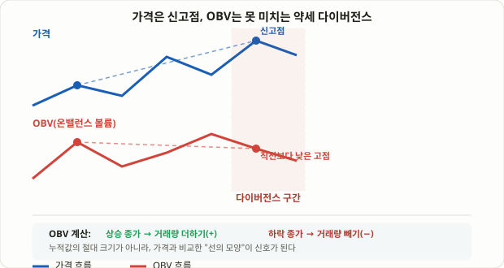

## OBV란 무엇인가: 거래량이 가격보다 먼저 말한다

OBV(On-Balance Volume, 온밸런스 볼륨)는 1963년 조 그랜빌(Joe Granville)이 고안한 거래량 지표로, "거래량이 가격을 선행한다"는 단순하지만 강력한 가설에서 출발합니다. 큰손이나 기관이 어떤 종목을 매집하기 시작할 때, 그 의도가 가격에 뚜렷하게 드러나기 전부터 거래량에는 이미 흔적이 남는다는 논리입니다. 눈에 보이는 가격은 아직 조용한데, 그 밑에서 누적되는 매수·매도 물량의 균형은 먼저 움직이고 있을 수 있다는 것입니다.

OBV의 계산 방식은 의도적으로 단순합니다. 종가가 전일 종가보다 올랐으면 그날 거래량을 더하고, 내렸으면 그날 거래량을 빼며, 변동이 없으면 그대로 둡니다. 이렇게 매일의 거래량을 플러스 혹은 마이너스로 분류해 누적한 하나의 선이 바로 OBV입니다. RSI나 스토캐스틱처럼 0~100 사이에 갇힌 오실레이터가 아니라, 시작점을 임의로 정한 뒤 끝없이 쌓여가는 누적선이라는 점이 특징입니다. 그래서 OBV의 절대값 자체는 의미가 없고, **그 선이 그리는 모양 — 특히 가격과 비교했을 때의 모양**이 신호가 됩니다.

## 계산법을 숫자로 직접 따라가 보기

말로만 설명하면 감이 잘 오지 않으니, 가상의 B 종목 6거래일 치 데이터로 직접 계산해보겠습니다. OBV의 시작값은 임의로 0에서 출발한다고 가정합니다.

| 거래일 | 종가 | 전일 대비 | 거래량 | OBV 변화 | 누적 OBV |
|---|---|---|---|---|---|
| 1일 | 10,000 | — | 50,000 | — | 0 |
| 2일 | 10,200 | 상승 | 80,000 | +80,000 | 80,000 |
| 3일 | 10,150 | 하락 | 40,000 | −40,000 | 40,000 |
| 4일 | 10,400 | 상승 | 120,000 | +120,000 | 160,000 |
| 5일 | 10,380 | 하락 | 30,000 | −30,000 | 130,000 |
| 6일 | 10,450 | 상승 | 60,000 | +60,000 | 190,000 |

여기서 주목할 부분은 3일과 5일입니다. 가격은 소폭 하락했지만 거래량 자체는 상승일보다 훨씬 적었습니다(40,000·30,000 vs 80,000·120,000). 결과적으로 OBV는 하락일의 작은 거래량을 빼고도 전체적으로는 꾸준히 우상향했습니다. 이는 "가격이 잠깐 쉬는 구간에서도 매도 공격은 미약했고, 상승일에 훨씬 강한 거래량이 몰렸다"는 뜻으로 읽을 수 있습니다 — 즉 추세를 뒷받침하는 수급이 건전하다는 신호입니다. 반대로 만약 3일·5일의 하락일 거래량이 상승일보다 더 컸다면 OBV는 하락했을 것이고, 이는 겉보기 상승에도 불구하고 매도 압력이 쌓이고 있다는 경고가 됩니다.

## 다이버전스: OBV가 가격에 동의하지 않을 때

OBV를 실전에서 가장 많이 쓰는 방식은 절대값이 아니라 **가격의 고점·저점과 OBV의 고점·저점을 나란히 비교하는 다이버전스(divergence) 분석**입니다.

- **약세 다이버전스(Bearish Divergence)**: 가격은 이전 고점을 넘어서는 신고점을 만들었는데, OBV는 이전 고점에 못 미치는 낮은 고점을 만든 경우입니다. 가격은 올랐지만 그 상승을 뒷받침하는 순매수 거래량은 오히려 약해졌다는 뜻이며, 소수의 투자자가 얇은 거래량으로 가격만 밀어올리고 있을 가능성을 시사합니다.
- **강세 다이버전스(Bullish Divergence)**: 가격은 이전 저점보다 더 낮은 신저점을 만들었는데, OBV는 이전 저점보다 높은 저점을 유지하거나 오히려 상승한 경우입니다. 가격은 밀렸지만 거래량으로 본 매도 압력은 그만큼 강해지지 않았다는 뜻으로, 매도세가 소진되고 있다는 신호로 해석됩니다.

<figure class="diagram">
  
  <figcaption>위: 가격은 신고점을 갱신하지만 OBV는 그에 못 미치는 약세 다이버전스 — 상승을 뒷받침하는 순매수 거래량이 줄어들고 있다는 신호. 아래: 상승 종가일에는 거래량을 더하고 하락 종가일에는 거래량을 빼는 OBV의 기본 계산 구조.</figcaption>
</figure>

다만 이 해석에는 반드시 단서가 붙어야 합니다. 다이버전스는 "추세의 힘이 빠지고 있다는 경고"일 뿐, "지금 당장 반전한다"는 보장이 아닙니다. 다이버전스가 뜬 뒤에도 가격이 몇 주씩 같은 방향으로 더 움직이는 경우가 흔하며, 실전에서는 다이버전스 확인 뒤 지지선·저항선 붕괴나 이동평균 이탈 같은 별도의 확인 신호를 기다린 뒤 진입하는 방식이 더 널리 쓰입니다. 또한 47강 [MACD 다이버전스](/strategies/macd-signal-divergence/)와 마찬가지로, 다이버전스 기반 신호는 "정도"의 문제이지 명확한 온오프 스위치가 아니라는 점도 같습니다.

## OBV 트렌드라인: 가격 추세선보다 먼저 깨지는 선

OBV를 활용하는 또 다른 방법은 OBV 선 자체에 추세선을 그려보는 것입니다. 가격의 상승 추세선과 마찬가지로 OBV의 저점들을 이어 상승 추세선을 그릴 수 있는데, 만약 가격의 추세선은 아직 멀쩍이 살아있는데 OBV의 추세선이 먼저 깨진다면, 이는 "거래량으로 본 매수 압력이 가격보다 먼저 꺾였다"는 조기 경고로 해석될 수 있습니다. 반대로 OBV가 직전 고점을 돌파하는 것을 보고 "거래량이 먼저 신고점을 만들었으니 가격도 뒤따를 가능성이 있다"고 보는 방식도 흔히 쓰입니다. 그랜빌은 이런 식으로 OBV의 저점을 "스프링(spring)", 고점 돌파를 매집의 증거로 설명했습니다.

## OBV vs CVD: 둘 다 누적 거래량 지표이지만 재료가 다르다

이 코스에서는 16강 [오더플로우 매매: 풋프린트 차트와 누적 델타(CVD)](/strategies/order-flow-footprint-cvd/)에서 이미 "누적되는 거래량 지표"를 다룬 적이 있습니다. OBV와 CVD는 둘 다 "쌓아 올린 거래량 선으로 매수·매도 압력을 읽는다"는 겉모습이 비슷해서 자주 혼동되지만, 분류 기준이 완전히 다릅니다.

| 구분 | OBV | CVD(누적 델타) |
|---|---|---|
| 분류 기준 | 캔들(봉) 전체의 종가가 전일보다 올랐는가 내렸는가 | 캔들 내부에서 틱 단위로 매수 호가를 공격했는가 매도 호가를 공격했는가 |
| 필요 데이터 | 종가·거래량만 있으면 계산 가능 | 호가 방향이 포함된 틱 단위 체결 데이터 필요 |
| 시간 해상도 | 하루(또는 한 캔들) 전체를 통째로 한 방향으로 분류 | 같은 캔들 안에서도 매수·매도가 섞여 있는 세부 구조까지 구분 |
| 접근성 | 일반적인 무료 차트 서비스에서 바로 계산 가능 | 전용 플랫폼이나 유료 데이터 구독이 필요한 경우가 많음 |
| 강점 | 장기 추세·스윙 구간에서 수급의 큰 흐름을 보기 쉬움 | 캔들 하나 내부의 미시적인 체결 강도 변화에 민감 |

쉽게 말해 OBV는 "그날 전체적으로 사는 쪽이 이겼는지 파는 쪽이 이겼는지"만 보고 그날의 거래량 전부를 한쪽에 몰아 배정하는 거친 분류법이고, CVD는 같은 캔들 안에서도 매수 체결과 매도 체결이 실제로 섞여 있는 비율까지 세밀하게 봅니다. 이 때문에 CVD가 훨씬 정밀하지만, 그만큼 비싼 데이터와 복잡한 설정이 필요합니다. 반면 OBV는 정밀도를 희생하는 대신 누구나 공짜로, 수십 년치 과거 데이터에도 똑같이 적용할 수 있다는 실용적 장점이 있습니다. 스윙 트레이더나 장기 투자자가 큰 그림의 수급 흐름을 가볍게 점검할 때는 OBV가, 스캘퍼나 단타 트레이더가 캔들 내부의 공격성을 봐야 할 때는 CVD가 더 적합한 도구라고 구분할 수 있습니다.

## 한계와 실전 유의점

- **거래량 전부를 한 방향에 몰아넣는 거친 계산법**: 그날 가격이 0.1%만 올랐어도 그날 거래량 전체가 "+"로 분류됩니다. 등락의 크기는 전혀 반영되지 않기 때문에, 작은 등락과 큰 등락이 OBV 상으로는 똑같은 무게를 갖습니다.
- **저유동성·저거래량 종목에서는 왜곡되기 쉽다**: 거래가 뜸한 종목은 하루의 우연한 거래량 급증 하나가 OBV 전체 모양을 크게 바꿔버릴 수 있어, 다이버전스 해석의 신뢰도가 떨어집니다.
- **다이버전스는 타이밍 신호가 아니다**: 앞서 언급했듯 다이버전스가 뜬 뒤에도 추세가 꽤 오래 지속되는 경우가 많습니다. OBV 다이버전스만으로 매수·매도를 결정하기보다, 지지·저항, 이동평균, RSI 같은 다른 지표와 함께 교차 확인하는 것이 일반적으로 권장되는 방식입니다.
- **시작점이 임의적이라 절대값은 무의미하다**: OBV가 "100만"이든 "-50만"이든 그 숫자 자체에는 의미가 없고, 오직 모양의 변화만 봐야 합니다. 차트 소프트웨어나 기간 설정을 바꾸면 시작점도 달라지므로, 서로 다른 기간의 OBV 값을 직접 비교하는 것은 의미가 없습니다.

## 자주 묻는 질문

### OBV 다이버전스가 나오면 바로 매수·매도해야 하나요?
아닙니다. 다이버전스는 "추세를 뒷받침하는 거래량 압력이 약해지고 있다"는 경고일 뿐이며, 반전의 정확한 시점을 알려주지는 않습니다. 실전에서는 다이버전스를 확인한 뒤에도 지지선·저항선 붕괴나 추세선 이탈 같은 가격 자체의 확인 신호를 기다린 뒤 진입하는 경우가 많습니다.

### OBV와 단순 거래량(volume) 지표는 뭐가 다른가요?
일반 거래량 지표는 그날의 거래량 크기만 바를 형태로 보여주고 방향을 구분하지 않습니다. OBV는 그 거래량을 가격 상승·하락 방향에 따라 플러스·마이너스로 분류한 뒤 끝없이 누적해서, 하나의 추세선처럼 볼 수 있게 만든다는 점이 가장 큰 차이입니다.

### OBV는 어떤 시장에서 특히 잘 맞나요?
거래량이 충분히 꾸준하고 공시된 대형주나 주요 지수, 활발히 거래되는 대형 암호화폐 등에서 더 신뢰할 만한 모양을 그리는 편입니다. 거래가 드문 소형주나 저유동성 종목에서는 우연한 거래량 급증 하나로 신호가 쉽게 왜곡될 수 있어 주의가 필요합니다.

## 정리

- OBV는 "거래량이 가격보다 먼저 움직인다"는 가설에서 출발해, 종가가 오른 날의 거래량은 더하고 내린 날의 거래량은 빼서 누적하는 단순한 지표입니다.
- 절대값 자체는 의미가 없고, 가격의 고점·저점과 OBV의 고점·저점을 비교하는 다이버전스(약세/강세)가 핵심 신호로 쓰입니다.
- OBV 선 자체에 추세선을 그려 가격보다 먼저 꺾이거나 먼저 돌파하는지를 보는 방식도 자주 활용됩니다.
- OBV와 CVD는 둘 다 누적 거래량 지표라는 점은 같지만, OBV는 캔들 전체를 통째로 분류하는 거친 방식이고 CVD는 캔들 내부의 틱 단위 체결까지 구분하는 정밀한 방식이라는 차이가 있습니다.
- 다이버전스는 타이밍을 정확히 찍어주는 신호가 아니며, 저유동성 종목에서는 왜곡되기 쉬우므로 다른 지표·가격 확인 신호와 함께 교차 검증하는 것이 안전합니다.
