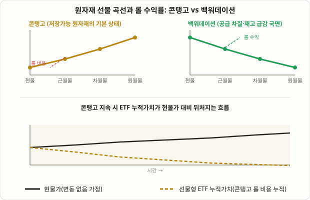

## 유가는 올랐는데 왜 내 원유 ETF는 덜 올랐을까

"국제유가가 두 배 가까이 뛰었다는데, 왜 내가 산 원유 ETF는 그 절반도 못 따라갔을까?" 원유·천연가스 ETF를 보유해 본 투자자라면 한 번쯔음 품어봤을 질문입니다. 정답은 대부분 **롤 수익률(Roll Yield)**에 있습니다. USO 같은 원자재 ETF는 실물 원유를 창고에 쌓아두는 게 아니라 만기가 있는 선물 계약을 사서 가격을 추종하는데, 만기가 다가오면 그 계약을 팔고 다음 만기 계약으로 갈아타는 **롤오버**를 매달 반복합니다. 이 과정에서 선물 곡선이 어떤 모양이냐에 따라 현물가가 전혀 움직이지 않아도 ETF의 가치가 조용히 깎이거나 반대로 덤으로 불어날 수 있습니다.

실제로 2026년 원유시장에서는 선물 곡선이 백워데이션으로 기울면서 USO·BNO 같은 선물형 ETF가 현물가 상승분보다 더 좋은 성과를 냈다는 보도가 여러 매체에서 나왔습니다. 반대로 같은 해 11월 천연가스 시장에서는 11월물이 만기 청산되고 12월물로 교체되는 과정에서 차월물 가격이 근월물보다 10%가 넘게 높게 거래됐다는 보도도 있었습니다(단일 매체 보도로, 정확한 수치는 거래소 정산가로 직접 확인이 필요합니다). 이처럼 롤 수익률은 뉴스 헤드라인에는 잘 나오지 않지만, 원자재 ETF의 실제 수익률을 좌우하는 핵심 변수입니다. 이 강의는 이 강좌에서 다룬 [28강 VIX 선물 기간구조](/strategies/vix-term-structure-contango-backwardation/)의 콘탱고·백워데이션 개념을 원자재 선물로 확장해, 유가·천연가스 ETF를 보유하거나 선물을 직접 거래할 때 왜 "곡선의 모양"부터 확인해야 하는지를 설명합니다.

## 롤이란 무엇이고 왜 필요한가

선물 계약은 모두 만기가 있습니다. 실물 인수를 원하지 않는 투자자(ETF 운용사를 포함해 대다수의 금융 투자자)는 만기가 오기 전에 보유 중인 계약(근월물)을 팔고, 만기가 더 먼 다음 계약(차월물)을 사는 방식으로 포지션을 계속 이어갑니다. 이 교체 작업이 바로 **롤오버(Roll-over)**입니다. 문제는 근월물 가격과 차월물 가격이 보통 서로 다르다는 점입니다. 이 가격차를 수익으로 바꾸거나 비용으로 치르게 되는 것이 바로 롤 수익률입니다.

## 콘탱고와 백워데이션: 선물 곡선의 두 얼굴

- **콘탱고(Contango)**: 만기가 먼 계약일수록 가격이 더 높은 상태로, 곡선이 우상향합니다. 롤오버를 할 때마다 싼 근월물을 팔고 비싼 차월물을 사야 하므로, 현물가가 그대로여도 시간이 지나며 손실이 서서히 쌓입니다.
- **백워데이션(Backwardation)**: 반대로 근월물이 차월물보다 비싼 상태로, 곡선이 우하향합니다. 비싼 근월물을 팔고 싼 차월물을 사게 되므로, 그 차월물이 시간이 지나 새로운 근월물이 되어 가격이 올라붙는 과정에서 추가 수익이 생길 여지가 있습니다.

<figure class="diagram">
  
  <figcaption>콘탱고(좌)에서는 싼 근월물을 팔고 비싼 차월물을 사며 롤 비용이 쌓이고, 백워데이션(우)에서는 반대로 롤 수익이 쌓인다. 아래 그래프는 콘탱고가 지속될 때 ETF 가치가 현물가보다 서서히 뒤처지는 모습을 보여준다.</figcaption>
</figure>

## 왜 이런 구조가 생기는가: 보관비용과 희소성의 줄다리기

콘탱고가 원자재 시장의 "기본값"에 가까운 이유는 **보관비용 모형(Cost-of-Carry)**으로 설명됩니다. 원유나 금속처럼 저장이 가능한 원자재를 지금 사서 미래에 넘겨주려면, 그동안 창고 임차료·보험료·자금 조달비용이 들어갑니다. 이 비용이 선물가격에 얹히기 때문에, 만기가 멀수록 가격이 비싸지는 쪽으로 자연스럽게 기울게 됩니다.

반대로 백워데이션은 **지금 당장의 희소성**이 미래의 희소성보다 훨씬 크게 느껴질 때 나타납니다. 공급이 갑자기 끊기거나(전쟁·제재·정제시설 가동 중단), 재고가 바닥을 보일 때는 "지금 당장 현물을 확보하는 것"의 가치가 올라가면서 근월물 수요가 차월물을 압도합니다. 경제학자 존 메이너드 케인스가 제시한 **정상 백워데이션(Normal Backwardation) 이론**은 여기에 한 가지 설명을 더합니다. 원유 생산자 같은 헤저(hedger)들은 가격 하락 위험을 피하려고 선물을 미리 팔아두려는 경향이 있는데, 이 매도 물량을 받아주는 투기자들에게 그만큼의 위험 프리미엄을 지불해야 하므로, 선물가격이 투기자가 기대하는 미래 현물가보다 구조적으로 낮게 형성되는 경향이 있다는 설명입니다. 다만 이 이론이 모든 원자재·모든 시기에 들어맞는 것은 아니며, 실제로는 수급 상황에 따라 콘탱고와 백워데이션을 오가는 경우가 더 흔합니다.

천연가스처럼 저장이 어렵고 계절 수요가 뚜렷한 원자재는 조금 다른 모양을 띱니다. 난방 수요가 몰리는 겨울철 인도분이 수요가 적은 여름철 인도분보다 구조적으로 비싸게 거래되는 경향이 자주 관찰되는데, 이는 공급 희소성이 아니라 **계절성 수요 패턴**이 곡선 모양을 만드는 경우입니다. 그래서 천연가스 선물 곡선은 1년 내내 콘탱고도, 백워데이션도 아닌 "겨울 봉우리와 여름 골짜기가 반복되는" 모양을 띠는 경우가 많습니다.

## 숫자로 보는 롤 수익률 계산 (설명용 가상 수치)

다음은 구조를 이해하기 위한 **가상의 예시**이며 실제 시장 호가가 아닙니다.

**콘탱고 상황**: 근월물(1개월물)이 배럴당 62달러, 차월물(2개월물)이 63달러에 거래되고 있다고 가정합니다. 롤오버를 하면 62달러에 팔고 63달러에 사야 하므로, 한 번 롤오버할 때마다 약 1.6%(1달러÷62달러)의 비용이 발생합니다. 매달 이 정도 비율로 롤오버가 반복된다고 가정하면(실제로는 콘탱고 폭이 매달 달라지므로 어림 계산일 뿐입니다), 단순 누적으로는 연 20%에 가까운 손실 압력이 될 수 있습니다. 이것이 유가가 1년간 제자리여도 선물형 ETF 투자자가 손실을 보는 이유입니다.

**백워데이션 상황**: 반대로 근월물이 70달러, 차월물이 68달러라면, 70달러에 팔고 68달러에 사는 롤오버를 하게 되므로 그 차이(2달러, 약 2.9%)만큼 현금이 남습니다. 이 돈으로 산 차월물이 시간이 지나 새로운 근월물이 되어 70달러 안팎으로 가격이 올라붙는다면, 이 2.9%는 실제 수익으로 전환됩니다.

| 구분 | 콘탱고 (근월물 62달러 < 차월물 63달러) | 백워데이션 (근월물 70달러 > 차월물 68달러) |
|---|---|---|
| 롤오버 시 행동 | 싼 근월물 매도 → 비싼 차월물 매수 | 비싼 근월물 매도 → 싼 차월물 매수 |
| 1회 롤오버 손익 | 약 -1.6% (롤 비용) | 약 +2.9% (롤 수익) |
| 현물가 불변 시 장기 보유 결과 | ETF 가치가 현물가 대비 서서히 뒤처짐 | ETF 가치가 현물가 대비 서서히 앞서감 |
| 흔히 나타나는 시장 | 천연가스, 곡물 등 저장비용이 크거나 계절성이 강한 원자재 | 공급 차질·재고 급감 국면의 원유 등 |

이 표의 수치는 이해를 돕기 위한 단순화된 가상 예시이며, 실제 ETF는 매달 롤오버 폭이 달라지고 운용보수·거래비용도 함께 작용하므로 실제 수익률과는 차이가 날 수 있습니다.

## 같은 지표를 쓰는 두 가지 접근: 프런트먼스 롤링 vs 최적수익 롤링

원자재 ETF가 롤오버를 설계하는 방식도 서로 다릅니다. 가장 단순한 방식은 매달 가장 가까운 근월물만 보유하다가 만기 직전에 바로 다음 근월물로 교체하는 **프런트먼스 롤링(Front-Month Rolling)**입니다. USO가 오랫동안 이 방식을 썼는데, 구조가 단순하고 가격 추적이 직관적이지만, 곡선이 가파른 콘탱고일 때는 롤 비용을 그대로 다 떠안는다는 단점이 있습니다.

이에 대한 대안으로 나온 것이 DBO 같은 ETF가 쓰는 **최적수익 롤링(Optimum Yield Rolling)**입니다. 매달 똑같이 다음 근월물로 넘어가는 대신, 전체 선물 곡선(보통 1년치 월물)을 살펴 "콘탱고 폭이 가장 좁거나 백워데이션 폭이 가장 넓은 지점"의 계약을 골라 롤오버하는 방식입니다. 매달 어느 계약으로 롤오버할지가 바뀔 수 있다는 점에서 구조가 더 복잡하지만, 이론적으로는 같은 콘탱고 시장에서도 롤 비용을 줄일 여지가 있습니다.

| 구분 | 프런트먼스 롤링 | 최적수익 롤링 |
|---|---|---|
| 방식 | 매달 가장 가까운 근월물만 보유 | 곡선 전체를 비교해 롤 비용이 가장 적은 지점 선택 |
| 장점 | 구조가 단순하고 현물가 추적이 직관적 | 가파른 콘탱고 구간의 롤 비용을 일부 완화할 여지 |
| 단점 | 콘탱고 폭을 그대로 떠안음 | 구조가 복잡해지고, 선택한 월물이 매달 바뀔 수 있어 추적이 덜 직관적 |
| 대표 상품 유형 | USO 등 전통적인 단일월물 추종 ETF | DBO 등 커머더티인덱스 기반 ETF |

어느 쪽도 콘탱고 자체를 없애주지는 못합니다. 곡선이 전반적으로 가파르게 콘탱고라면 최적수익 방식도 손실 압력을 "완화"할 뿐이지 "제거"하지는 못한다는 점은 분명히 짚어둘 필요가 있습니다.

## 실전에서 확인해야 할 것들

- **보유하려는 상품의 롤오버 방식을 투자설명서에서 확인한다.** 같은 '원유 ETF'라도 프런트먼스 방식인지 최적수익 방식인지에 따라 같은 유가 흐름에서도 수익률이 달라질 수 있습니다.
- **매수 전에 선물 곡선의 모양을 직접 확인한다.** 거래소나 증권사 HTS에서 근월물·차월물·원월물 가격을 나열해 보면, 지금 콘탱고인지 백워데이션인지, 그 폭이 얼마나 되는지를 가늠할 수 있습니다.
- **장기 보유 목적이라면 롤 비용이 누적된다는 점을 전제한다.** [72강 레버리지 ETF 변동성 끌림](/strategies/leveraged-etf-volatility-decay/)에서 다룬 매일 재조정형 상품의 변동성 끌림과는 발생 원리가 다르지만, "장기 보유에는 구조적으로 불리할 수 있다"는 결론은 비슷하게 적용됩니다.
- **백워데이션은 영구적이지 않다.** 공급 차질이 해소되거나 재고가 다시 쌓이면 곡선은 다시 콘탱고로 돌아갈 수 있으므로, 지금의 롤 수익이 계속된다고 가정하고 베팅하는 것은 위험합니다.
- **곡선의 모양은 가격 방향을 알려주지 않는다.** 백워데이션이라고 현물가가 반드시 오른다는 뜻은 아니며, 콘탱고라고 반드시 내린다는 뜻도 아닙니다. 이 지표는 "ETF 수익률과 현물가 수익률이 얼마나 벌어질지"를 가늠하는 용도로 쓰는 것이 안전합니다.

## 자주 묻는 질문

### 콘탱고인 원유 ETF는 무조건 피해야 하나요?
단기 트레이딩 목적이라면 롤오버가 자주 일어나지 않으므로 영향이 상대적으로 작지만, 몇 달 이상 보유할 계획이라면 콘탱고 폭을 반드시 확인해야 합니다. 곡선이 가파른 콘탱고 상태에서 장기 보유하면 현물가가 올라도 ETF 수익률은 그보다 낮게 나올 가능성이 높습니다.

### 28강의 VIX 기간구조와 이 강의의 콘탱고·백워데이션은 같은 개념인가요?
기본 개념(근월물·원월물 가격차, 롤 수익률)은 동일합니다. 다만 [28강 VIX 선물 기간구조](/strategies/vix-term-structure-contango-backwardation/)는 변동성이라는 추상적인 지표의 선물을 다루고, 주로 시장의 공포·안정 심리를 반영합니다. 이 강의가 다루는 원유·천연가스 선물은 실물 상품이라 보관비용·계절수요·실제 공급 차질 같은 물리적 요인이 곡선 모양에 직접 개입한다는 점에서 원인 구조가 다릅니다.

### 개인 투자자가 직접 선물을 롤오버해야 하나요?
대부분의 개인 투자자는 ETF를 통해 간접적으로 노출을 얻으므로 롤오버 자체를 운용사가 대신 처리합니다. 다만 "운용사가 대신 해준다"는 것이 "비용이 사라진다"는 뜻은 아니므로, 그 비용이 ETF 수익률에 어떻게 반영되는지는 투자자가 직접 확인해야 합니다.

## 정리

- 원자재 ETF는 실물이 아니라 만기가 있는 선물을 추종하며, 만기가 다가올 때마다 근월물을 팔고 차월물을 사는 롤오버를 반복합니다.
- 차월물이 근월물보다 비싼 콘탱고에서는 롤오버마다 비용이 쌓이고, 반대로 차월물이 더 싼 백워데이션에서는 롤오버마다 수익이 쌓일 수 있습니다.
- 콘탱고는 보관비용 때문에 저장 가능한 원자재의 기본값에 가까운 경향이 있고, 백워데이션은 공급 차질·재고 급감처럼 "지금 당장의 희소성"이 부각될 때 나타나는 경우가 많습니다.
- 천연가스처럼 계절 수요가 강한 원자재는 콘탱고·백워데이션보다 "겨울 봉우리-여름 골짜기" 같은 계절성 곡선 모양으로 이해하는 것이 더 정확합니다.
- 프런트먼스 롤링과 최적수익 롤링은 같은 콘탱고 환경에서도 롤 비용을 얼마나 떠안을지를 다르게 설계하지만, 어느 쪽도 가파른 콘탱고 자체를 없애지는 못합니다.
- 장기 보유를 고려한다면 매수 전에 선물 곡선의 모양과 투자설명서의 롤오버 방식을 반드시 확인하는 것이 손익 격차를 줄이는 가장 실용적인 방법입니다.
