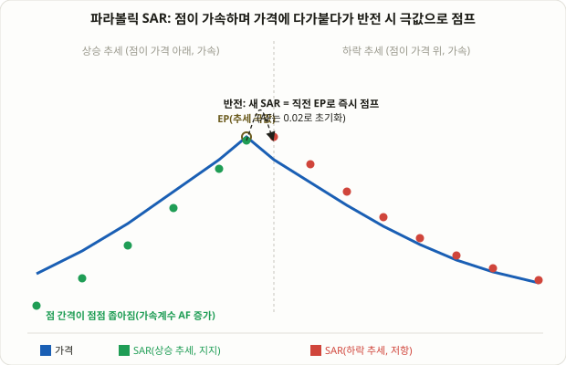

## 가격 위아래에 찍히는 점 하나가 하는 두 가지 일

차트에서 가격 위나 아래에 작은 점들이 줄지어 찍혀 있다가, 어느 순간 점이 반대편으로 훌쩍 넘어가는 지표를 본 적이 있다면 그것이 바로 **파라볼릭 SAR(Parabolic Stop And Reversal)**입니다. [65강 슈퍼트렌드](/strategies/supertrend-indicator/)에서 "개념 자체는 웰레스 와일더의 파라볼릭 SAR과 같은 계열"이라고 언급했듯, 사실 파라볼릭 SAR은 슈퍼트렌드보다 먼저 나온 원조 격 지표입니다. 1978년 J. 웰레스 와일더(J. Welles Wilder Jr.)가 저서 《New Concepts in Technical Trading Systems》에서 RSI, [55강 ADX·DMI](/strategies/adx-dmi-trend-strength/), [13강 ATR](/strategies/risk-filters-atr-cmf/)과 함께 소개했습니다. 네 지표가 모두 같은 책, 같은 저자에서 나왔다는 사실은 우연이 아닙니다 — 와일더는 "추세를 따라가는 도구(SAR)"와 "그 추세가 신뢰할 만한 국면인지 가늠하는 도구(ADX)"를 짝으로 설계했다는 설명이 기술적 분석 커뮤니티에서 널리 통용됩니다.

파라볼릭 SAR의 이름 자체가 기능을 그대로 말해줍니다. "Stop And Reversal", 즉 손절이자 반전 신호라는 뜻입니다. 점이 가격 아래에 찍혀 있으면 상승 추세이자 그 점이 곧 트레일링 손절가이고, 점이 가격 위로 넘어가면 하락 추세로 전환되며 동시에 손절가도 반대편으로 옮겨갑니다. 방향과 손절가를 하나의 점으로 동시에 제공한다는 점에서 슈퍼트렌드와 발상이 똑같지만, 점이 가속하는 방식은 완전히 다릅니다.

## 왜 "가속"하는가 — 추세가 늘어질수록 손절을 조이는 심리

파라볼릭 SAR을 이해하는 핵심은 이름의 "파라볼릭(포물선)"이 가리키는 가속 구조입니다. 추세 초반에는 점이 가격에서 멀리 떨어져 널찍한 여유를 주고, 추세가 오래 지속될수록 점이 가격 쪽으로 점점 빠르게 다가옵니다. 이 설계에는 분명한 시장 심리가 깔려 있습니다.

- **추세 초반**: 막 시작된 추세는 정상적인 되돌림(눌림목)에도 쉽게 흔들립니다. 손절을 바짝 붙이면 진짜 추세조차 조기에 털려나갑니다. 그래서 점은 처음에는 느리게 움직입니다.
- **추세 중반 이후**: 추세가 길어질수록 "이 추세가 끝날 때가 다가오고 있다"는 확률적 경계심이 커집니다. 동시에 이미 쌓인 이익을 지켜야 할 필요성도 커집니다. 그래서 점은 새로운 신고가(또는 신저가)가 나올 때마다 조금씩 더 빠르게 가격을 따라붙습니다.
- **결과**: 초반에는 여유를 주고 후반에는 이익을 지키는, 사람이 직관적으로도 하고 싶어 하는 "추세가 늘어질수록 보수적으로 바뀐다"는 태도를 숫자로 자동화한 것이 파라볼릭 SAR의 본질입니다.

이 가속은 가격의 실제 변동성(ATR)과는 무관하게, 오로지 "새로운 극값이 몇 번 나왔는가"라는 시간적 진행에 따라서만 일어납니다. 이 점이 뒤에서 다룰 슈퍼트렌드와의 가장 근본적인 차이입니다.

## 계산 원리: SAR, EP, 가속계수(AF) 세 요소

파라볼릭 SAR의 공식 자체는 단순합니다.

**다음 SAR = 현재 SAR + AF × (EP − 현재 SAR)**

- **SAR**: 오늘 계산된, 트레일링 손절가이자 다음 날 점이 찍힐 값.
- **EP(Extreme Point, 극값)**: 현재 추세가 시작된 이후 기록된 최고가(상승 추세) 또는 최저가(하락 추세).
- **AF(Acceleration Factor, 가속계수)**: 보통 0.02에서 시작해, 새로운 EP가 갱신될 때마다 0.02씩 증가하고, 최대 0.2에서 더 이상 늘지 않습니다. 이 0.02/0.02/0.2라는 숫자는 와일더가 제시한 이후 업계 관행으로 굳어진 기본값일 뿐, 절대적인 규칙은 아닙니다.

여기에 기술적으로 한 가지 보정 규칙이 더 있습니다. 상승 추세에서 SAR 값은 당일 또는 전일의 저가보다 높게 설정될 수 없습니다(하락 추세는 반대). 가속이 지나치게 빨라져 점이 가격 구조를 뚫고 올라가 버리는 비현실적인 상황을 막기 위한 안전장치입니다.

### 숫자로 보는 계산 예시

어떤 종목이 48,000원에서 상승 추세를 시작했다고 해보겠습니다. AF는 0.02에서 출발합니다.

| 일차 | 그날의 고가 | EP(갱신 여부) | AF | SAR 계산 | 다음 SAR |
|---|---|---|---|---|---|
| 1일차 | 50,000원 (추세 시작 고점) | EP = 50,000 | 0.02 | 48,000 + 0.02×(50,000−48,000) | **48,040원** |
| 2일차 | 50,500원 (신고가) | EP 갱신 → 50,500 | 0.04 | 48,040 + 0.04×(50,500−48,040) | **48,138원** |
| 3일차 | 51,200원 (신고가) | EP 갱신 → 51,200 | 0.06 | 48,138 + 0.06×(51,200−48,138) | **48,322원** |
| 4일차 | 51,000원 (신고가 아님) | EP 유지 51,200 | 0.06 (유지) | 48,322 + 0.06×(51,200−48,322) | **48,495원** |

여기서 핵심은 4일차입니다. 신고가가 나오지 않았으므로 EP도 AF도 그대로 유지되지만, SAR은 여전히 EP 쪽으로 조금씩 끌려 올라갑니다. 즉 추세가 잠시 쉬어가는 동안에도 손절선은 계속 가격 쪽으로 좁혀집니다.

이제 5일차에 하락 캔들이 나와 저가가 48,200원까지 떨어지고, 종가가 48,100원으로 마감했다고 해보겠습니다. 저가(48,200원)가 SAR(48,495원)보다 낮아졌으므로 — 즉 가격이 SAR 점을 하향 이탈했으므로 — 추세가 전환됩니다. 이때 벌어지는 일이 파라볼릭 SAR의 가장 독특한 특징입니다.

- **새 SAR = 직전 추세의 EP**: 하락 추세로 전환되는 순간, 새 SAR 값은 직전 상승 추세에서 기록된 극값인 51,200원으로 즉시 점프합니다. 점이 가격 아래 48,495원에 있다가 가격 위 51,200원으로 한 번에 넘어가는 것입니다.
- **AF 초기화**: 새로운 추세가 시작됐으므로 AF는 다시 0.02로 리셋됩니다.
- **새 EP**: 하락 추세의 EP는 전환 시점의 최저가(여기서는 48,100원 부근)부터 새로 추적을 시작합니다.

이 "직전 극값으로의 점프"가 왜 중요한지는 다음 절에서 다룹니다.

<figure class="diagram">
  
  <figcaption>상승 추세(왼쪽)에서는 점이 가격 아래에서 신고가가 나올 때마다 가속계수가 커지며 점점 빠르게 가격에 다가붙고, 가격이 점을 하향 이탈하면(반전) 점은 직전 추세의 극값(최고점) 위로 즉시 점프해 하락 추세의 저항점으로 바뀐다.</figcaption>
</figure>

## 실전 매매 규칙: 단독 반전 신호 vs 트레일링 스톱 보조

와일더가 원래 설계한 방식은 "항상 시장에 있는" 시스템이었습니다. 점이 위로 넘어가면 롱을 청산하고 즉시 숏으로 전환하고, 점이 아래로 넘어가면 그 반대로 — 쉬는 구간 없이 계속 포지션을 보유하는 구조입니다. 하지만 실전에서는 두 가지 쓰임새로 나뉘어 쓰이는 경우가 더 많습니다.

1. **단독 반전 시스템**: 점 플립 자체를 진입·청산 신호로 쓰는 원래 방식. 뚜렷한 단방향 추세장에서는 잘 맞지만, 뒤에서 다룰 한계 때문에 횡보장에서는 손실이 반복되기 쉽습니다.
2. **트레일링 스톱 보조 도구(더 흔한 실전 활용)**: 이동평균선 정배열이나 [48강 BOS](/strategies/market-structure-bos-choch/) 같은 별도의 신호로 진입한 뒤, 파라볼릭 SAR의 점 값을 손절가로만 활용하는 방식. 점이 추세 방향으로만 끌려오기 때문에 수동으로 손절을 재조정할 필요 없이 자동으로 트레일링됩니다.
3. **국면 필터 병행**: 파라볼릭 SAR 자체는 "지금이 추세장인지 횡보장인지"를 구분하지 못합니다. 와일더 본인이 같은 책에서 ADX를 함께 제시한 것도, SAR 같은 추세추종형 시스템을 신뢰할 수 있는 국면인지 가늠하기 위한 보완 장치였다는 설명이 많습니다. [55강 ADX·DMI](/strategies/adx-dmi-trend-strength/)의 25 기준선을 넘는 구간에서만 SAR 신호를 따르고, 그 아래에서는 무시하거나 비중을 줄이는 방식이 실전에서 자주 권장됩니다.

## 가속계수(AF) 설정값: 무엇을 바꾸면 무엇이 달라지는가

조정 가능한 값은 시작 AF, 증가폭, 최대 AF 세 가지입니다. 플랫폼 대부분은 0.02 / 0.02 / 0.2를 기본값으로 제공합니다.

| 설정 | 특징 | 적합한 스타일 |
|---|---|---|
| 느린 설정 (예: 시작 0.01, 증가 0.01, 최대 0.1) | 점이 가격에서 멀리 유지됨, 반전이 늦지만 조기 이탈도 적음 | 스윙·포지션 트레이딩 |
| 표준값 (0.02 / 0.02 / 0.2) | 업계에서 가장 널리 쓰이는 기본값 | 데이트레이딩~단기 스윙 |
| 빠른 설정 (예: 시작 0.03, 증가 0.02, 최대 0.2) | 점이 가격에 빨리 붙음, 반전이 빠르지만 휩소도 잦음 | 짧은 추세를 빠르게 타는 스타일 |

표준값 0.02/0.02/0.2가 가장 자주 인용되지만, 이는 와일더가 예시로 제시한 값이 관행으로 굳어진 것에 가깝습니다. 변동성이 큰 코인이나 소형주에서는 기본값 그대로 쓰면 가속이 너무 빨라 뚜렷한 추세 중에도 조기 반전이 잦다는 지적이 흔히 제기됩니다.

## 파라볼릭 SAR vs 슈퍼트렌드: 같은 족보, 다른 가속 방식

[65강](/strategies/supertrend-indicator/)에서 다룬 슈퍼트렌드와 파라볼릭 SAR은 "방향과 손절가를 하나의 선(점)으로 제공한다"는 목적이 완전히 같고, 와일더라는 뿌리도 같습니다. 하지만 거리를 결정하는 방식이 근본적으로 다릅니다.

| 구분 | 파라볼릭 SAR | 슈퍼트렌드 |
|---|---|---|
| 거리를 결정하는 기준 | 시간적 진행(신고가·신저가 갱신 횟수)에 따라 가속계수가 누적 증가 | ATR × 배수(해당 종목의 실제 변동성 절대값) |
| 변동성 반영 | 반영하지 않음 — 변동성이 커도 작아도 가속 속도는 똑같이 진행 | 직접 반영 — 변동성이 커지면 밴드 자체가 넓어짐 |
| 반전 시 동작 | 새 SAR이 직전 추세의 극값(EP)으로 즉시 점프 | 반대편 밴드 값으로 전환(점프 폭이 ATR 배수에 따라 상대적으로 작음) |
| 조정 변수 개수 | 3개(시작 AF, 증가폭, 최대 AF) | 2개(ATR 기간, 배수) |
| 시각적 신호 | 점(dot)이 연속으로 찍히며 가속을 시각적으로 체감 가능 | 선(line)이 밴드 형태로 이어짐 |
| 장기 추세에서의 약점 | 추세가 길어질수록 AF가 최대치(0.2)에 도달해 점이 지나치게 가격에 밀착 — 정상적인 눌림목에도 조기 이탈 위험 | ATR 기반이라 변동성이 유지되는 한 밴드 폭이 비교적 일관되게 유지됨 |

실전에서 흔히 언급되는 구분은, 변동성이 비교적 안정적이고 뚜렷한 단방향 추세가 기대되는 국면에는 파라볼릭 SAR이 직관적이고, 변동성이 구간별로 달라지는 종목(코인, 성장주)에는 ATR 기반인 슈퍼트렌드가 더 안정적으로 작동하는 경향이 있다는 평가입니다. 두 지표를 같은 차트에 띄워 두고 방향이 일치할 때만 신호를 신뢰하는 조합도 커뮤니티에서 자주 소개됩니다.

## 한계와 주의할 점

- **횡보장에서 반복 손실**: 가격이 방향 없이 좁게 등락하면 점이 짧은 간격으로 계속 플립하며, 매번 수수료·슬리피지만 소모하는 손실이 쌓입니다. 이른바 "횡보장의 저주"는 모든 스탑앤리버스형 지표의 공통 약점입니다.
- **장기 추세 후반부의 과민 반응**: AF가 최대치에 도달하면 점이 가격에 지나치게 밀착해, 정상적인 눌림목만으로도 조기 반전 신호가 나올 수 있습니다.
- **변동성 무시**: 같은 설정을 저변동성 대형주와 고변동성 소형주·코인에 그대로 적용하면 전혀 다른 성격의 신호가 나옵니다. ATR 같은 변동성 지표로 종목별 성격을 먼저 확인하는 것이 안전합니다.
- **갭에 취약**: 장 시작 갭이 SAR 점을 훌쩍 넘어버리면 실제 체결가는 계산된 손절가보다 훨씬 불리한 가격일 수 있습니다.
- **후행지표다**: 추세가 이미 진행된 뒤에야 방향이 확정되는 구조라, 바닥·천장을 정확히 잡아주는 지표는 아닙니다.

## 자주 묻는 질문

### 파라볼릭 SAR만으로 매매해도 되나요?

권장되지 않습니다. 횡보장을 스스로 구분하지 못한다는 한계가 뚜렷하기 때문에, [55강 ADX](/strategies/adx-dmi-trend-strength/) 같은 국면 필터나 이동평균선 정배열 같은 별도 추세 확인과 함께 쓰는 것이 일반적인 관행입니다.

### 파라볼릭 SAR과 슈퍼트렌드 중 어느 쪽이 더 나은가요?

절대적으로 우월한 쪽은 없습니다. 파라볼릭 SAR은 거리를 시간(가속계수)으로 결정하고 슈퍼트렌드는 ATR(실제 변동성)로 결정한다는 점이 가장 큰 차이이며, 변동성이 일정한 종목에는 SAR이, 변동성 변화가 큰 종목에는 슈퍼트렌드가 더 안정적이라는 평가가 흔합니다. 실전에서는 두 지표를 함께 띄우고 방향이 겹치는 구간만 신뢰하는 방식도 쓰입니다.

### 암호화폐나 해외주식에도 그대로 쓸 수 있나요?

계산 방식 자체는 자산군과 무관하게 동일하게 적용됩니다. 다만 코인처럼 24시간 거래되고 변동성이 큰 자산에서는 기본값(0.02/0.02/0.2) 그대로 쓰면 플립이 지나치게 잦아지는 경우가 많아, 가속계수를 낮추거나 더 긴 시간프레임에서 확인하는 조정이 자주 권장됩니다.

## 정리

- 파라볼릭 SAR은 와일더가 1978년 ADX·ATR·RSI와 함께 제시한 지표로, 가격 위아래에 점을 찍어 추세 방향과 트레일링 손절가를 동시에 제공합니다.
- 핵심 공식은 "다음 SAR = 현재 SAR + AF × (EP − 현재 SAR)"이며, AF는 신고가·신저가가 나올 때마다 가속하고(보통 0.02씩, 최대 0.2) EP는 현재 추세의 극값입니다.
- 추세가 전환되면 새 SAR은 직전 추세의 극값으로 즉시 점프하고 AF는 0.02로 초기화됩니다 — 이 점프 구조가 파라볼릭 SAR만의 독특한 특징입니다.
- [65강 슈퍼트렌드](/strategies/supertrend-indicator/)와 목적은 같지만, 거리를 시간(가속계수)으로 정하는 파라볼릭 SAR과 변동성(ATR)으로 정하는 슈퍼트렌드는 장기 추세·고변동성 구간에서 서로 다른 약점을 보입니다.
- 횡보장에서는 반복 손실에 취약하므로, [55강 ADX·DMI](/strategies/adx-dmi-trend-strength/) 같은 국면 필터와 함께 단독 반전 신호보다는 트레일링 스톱 용도로 쓰는 것이 더 안전한 실전 활용법으로 흔히 권장됩니다.
