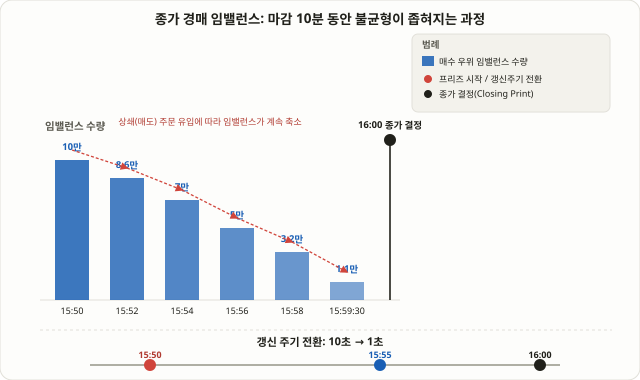

## 마감 10분, 숨겨진 수급이 공개되는 순간

정규장이 끝나기 10분 전, 차트에는 보이지 않는 숫자 하나가 거래소 데이터 피드를 통해 공개됩니다. 바로 **MOC 임밸런스(Market-on-Close Imbalance)**, 즉 종가에 반드시 체결되길 원하는 매수 주문과 매도 주문 중 아직 짝이 맞지 않은 쪽의 수량입니다. 이 글에서 다룰 **MOC 임밸런스 매매법**은 이 공개 수량을 읽고, 마감까지 남은 몇 분 동안 그 불균형이 어떻게 좁혀지거나 벌어지는지를 추적해 방향성 힌트를 얻는 방법입니다. 캔들차트가 보여주는 것은 이미 끝난 체결의 결과이지만, MOC 임밸런스는 "아직 체결되지 못해서 마감 전까지 반드시 처리돼야 할" 미래의 수급을 미리 보여준다는 점에서 완전히 다른 정보입니다.

이 데이터는 우연히 노출되는 것이 아니라 거래소가 제도적으로 공개하도록 설계된 것입니다. NYSE와 나스닥 모두 패시브 펀드·인덱스 추종 자금이 종가 한 번에 맞춰 대량으로 체결되는 구조이기 때문에, 그 큰 물량이 시장에 던져지기 전에 반대편 주문을 유도해 가격 충격을 줄이자는 취지로 임밸런스 수량을 미리 공개합니다. 역설적으로, 바로 이 공개된 정보 자체가 마감 직전 몇 분 동안 활발히 거래되는 트레이더들의 참고 지표가 됩니다.

## 왜 종가 경매가 점점 더 중요해지는가

과거에는 종가가 그날 거래의 마지막 체결가일 뿐이었지만, 지금은 그 비중 자체가 달라졌습니다. Bogousslavsky와 Muravyev의 연구는 2018년 기준 미국 주식 전체 거래량의 약 7.5%가 종가 경매 한 번에 체결됐다고 보고했습니다. 이는 어디까지나 특정 시점의 학술적 추정치이며 지금 이 순간의 정확한 비율로 받아들여서는 안 되지만, 인덱스펀드·ETF로의 자금 이동이 그 이후로도 꾸준히 이어져 왔다는 점을 생각하면 "종가 경매의 비중이 과거보다 커졌다"는 방향성 자체는 합리적으로 받아들여지는 설명입니다.

이 비중이 커진 이유는 단순합니다. S&P500 인덱스펀드 같은 패시브 상품은 벤치마크와의 추적오차를 최소화해야 하는데, 그러려면 당일 종가 가격으로 리밸런싱 물량을 체결해야 합니다. [75강 지수 편입 효과](/strategies/index-inclusion-effect/)에서 다룬 "편입 발표 이후 패시브 펀드의 강제 매수"도 결국 대부분 종가 경매를 통해 체결됩니다. 매달, 매분기 이런 물량이 반복되고, 특히 [107강 트리플 위칭 데이](/strategies/triple-witching-day/)처럼 지수 리밸런싱과 옵션·선물 만기가 겹치는 날에는 평소보다 훨씬 큰 임밸런스가 공개되곤 합니다.

## 임밸런스 수량 읽는 법: Imbalance Quantity vs Paired Quantity

거래소가 공개하는 데이터를 제대로 읽으려면 두 숫자를 구분해야 합니다.

- **Paired Quantity(페어링 수량)**: 현재 예상 체결가에서 매수와 매도가 서로 짝이 맞아 체결될 수 있는 물량.
- **Imbalance Quantity(임밸런스 수량)**: 그 가격에서 짝을 찾지 못하고 한쪽으로 남아 있는 물량. 임밸런스가 매수 쪽이면 "이 가격에 팔겠다는 물량이 부족하다", 매도 쪽이면 "이 가격에 사겠다는 물량이 부족하다"는 뜻입니다.

NYSE 리서치 자료를 분석한 한 연구(2011~2018년 피드 데이터 기준)는 임밸런스 수량이 페어링 수량에 비해 NYSE에서는 평균 51% 수준으로 매우 크지만, 나스닥에서는 장 마감 5분 전(15:55) 기준으로 평균 1% 수준에 그친다고 보고했습니다. 두 거래소의 경매 방식과 참여 구조가 다르기 때문에 나오는 차이로 해석되며, 이 숫자 자체를 외우기보다는 "같은 '임밸런스'라는 용어라도 거래소마다 체감되는 규모와 신뢰도가 다르다"는 교훈으로 받아들이는 것이 실전에서 더 유용합니다.

## 타임라인: 15:50 프리즈부터 16:00 결정까지

마감 임밸런스 매매의 핵심은 이 10분 동안 숫자가 어떻게 갱신되는지 아는 것입니다. (시각은 미국 동부시간 기준이며, 거래소·주문유형·이용 증권사 정책에 따라 세부 사항이 달라질 수 있습니다.)

| 시각(ET) | NYSE | 나스닥 |
|---|---|---|
| 15:50 | 클로징 프리즈 시작 — 이후 상쇄(offsetting) MOC/LOC 주문만 신규 접수, 기존 주문 취소도 원칙적으로 거부 | 클로징 크로스 임밸런스 정보 최초 공개, 10초마다 갱신 |
| 15:50~15:55 | 임밸런스 수량·예상 체결가 공개, 플로어 브로커들이 반대편 주문 탐색 | 10초 간격 갱신 지속 |
| 15:55 | 유의미하게 큰 불균형(Significant Imbalance)일 경우, 그 반대 방향 주문만 예외적으로 늦게 접수 허용 | 갱신 주기가 10초에서 1초로 전환 — 정보가 훨씬 빠르게 움직이기 시작 |
| 15:55~16:00 | 상쇄 주문 유입에 따라 임밸런스 수량이 계속 변동 | 1초 간격 갱신, 임밸런스 수량이 빠르게 좁혀지거나 유지됨 |
| 16:00 | 종가 결정(Closing Print) — 최종 체결가와 수량 확정 | 클로징 크로스 체결, 당일 공식 종가 확정 |

<figure class="diagram">
  
  <figcaption>장 마감 10분 전 공개된 매수 우위 임밸런스(파란 막대)는 상쇄 매도 주문이 유입될수록 점차 줄어들며, 갱신 주기는 15:55를 기점으로 10초에서 1초로 빨라져 마지막 5분간 정보가 훨씬 빠르게 갱신된다.</figcaption>
</figure>

이 표에서 가장 중요한 실전 포인트는 "숫자가 고정돼 있지 않다"는 점입니다. 15:50에 공개된 매수 임밸런스 10만 주가 15:58에도 그대로 10만 주로 남아 있을 가능성은 낮습니다. 그 사이 상쇄 주문이 들어오며 수량이 줄어들거나, 반대로 추가 매수 주문이 더해지며 오히려 커질 수도 있습니다. 즉 15:50의 초기 수치 하나만 보고 판단하는 것이 아니라, 10분 동안의 변화 추이 자체가 정보입니다.

## 상쇄(Offsetting) 주문과 동조(Joining) 주문의 차이

공개된 임밸런스를 보고 들어오는 추가 주문은 성격이 완전히 다른 두 가지로 나뉩니다.

- **상쇄 주문(Offsetting Order)**: 공개된 불균형의 반대 방향으로 들어오는 주문. 매수 임밸런스 10만 주가 공개됐다면, 매도 MOC 주문 10만 주가 들어오는 순간 불균형이 완전히 상쇄되어 0이 됩니다. 거래소가 클로징 프리즈 이후에도 신규 접수를 허용하는 것은 원칙적으로 이 상쇄 주문뿐입니다.
- **동조 주문(Joining Order)**: 공개된 불균형과 같은 방향으로 들어오는 주문. 매수 임밸런스가 공개된 상태에서 추가 매수 주문이 들어오면 불균형은 오히려 더 커집니다.

실전에서 종가 근처 가격 움직임을 해석할 때는 "지금 들어오는 추가 물량이 상쇄인지 동조인지"를 구분하는 것이 핵심입니다. 상쇄 주문이 계속 들어오며 임밸런스가 빠르게 줄어드는 흐름이라면 마감 가격이 생각보다 완만하게 결정될 가능성이 크고, 반대로 동조 주문이 계속 쌓이며 불균형이 줄지 않거나 커지는 흐름이라면 마감 순간 가격이 그 방향으로 튈 위험이 커집니다.

## 실전 접근법 두 가지: 임밸런스 페이드 vs 임밸런스 팔로우

공개된 임밸런스를 보고 실전에서 취할 수 있는 접근법은 크게 두 갈래로 갈립니다. 둘은 전제 자체가 반대이므로 나란히 비교해보는 것이 이해에 도움이 됩니다.

| 구분 | 임밸런스 팔로우(추세추종) | 임밸런스 페이드(역추세) |
|---|---|---|
| 핵심 가정 | 공개된 불균형은 마감까지 완전히 해소되지 않고, 남은 물량이 종가를 그 방향으로 밀어붙인다 | 큰 불균형은 이미 시장에 널리 알려진 정보라 상쇄 주문이 몰려들며, 종가 이후 가격이 되돌림(평균회귀)하는 경향이 있다 |
| 진입 시점 | 15:50~15:55 공개 직후, 큰 불균형 방향으로 소량 진입 | 15:58~16:00 임밸런스가 극단적으로 크게 유지되는 구간, 반대 방향 베팅 |
| 근거 | 패시브 자금은 가격과 무관하게 반드시 종가로 체결돼야 하므로 물량 자체가 가격을 밀어낸다는 논리 | 이미 공개된 정보는 플로어 브로커·HFT가 가장 먼저 반응해 상쇄시키므로, 뒤늦게 같은 방향으로 따라가는 쪽이 오히려 불리하다는 논리 |
| 참고할 연구 | — | Frei·Yan의 최적 집행 모델은 나스닥 종가 기준으로, 임밸런스 공개 이후에 뒤따라 들어가는 것보다 공개 전에 주문 일부를 미리 분할 집행하는 쪽이 유리하다고 분석했습니다 |
| 주된 리스크 | 마감 직전 대형 상쇄 주문 한 번에 불균형이 순식간에 사라지며 역방향으로 급변 | 불균형이 끝까지 해소되지 않고 그대로 종가에 반영돼 예상과 반대로 손실 |

두 접근법 모두 "이 방법이 항상 이긴다"는 근거는 없습니다. 위 표의 연구 결과가 시사하는 바는 오히려 "임밸런스가 공개된 뒤에 그 방향을 뒤따라 들어가는 단순한 팔로우 전략은 생각보다 불리할 수 있다"는 쪽에 가깝습니다. 실전에서는 임밸런스의 절대 크기(평소 거래량 대비 비율), 변화 추이(줄어드는지 커지는지), 그리고 그날이 트리플 위칭·지수 리밸런싱이 겹치는 특수한 날인지를 함께 따져야 합니다.

## 데이터 접근과 특수한 날짜 체크

MOC 임밸런스 데이터는 아무 차트에나 떠 있는 정보가 아닙니다. NYSE의 OpenBook, 나스닥의 TotalView 같은 레벨2급 유료 데이터 피드나 일부 전문 트레이딩 플랫폼을 통해서만 실시간으로 확인할 수 있고, 일반 무료 차트에는 보통 제공되지 않습니다. 접근 가능한 데이터 소스가 없다면 이 정보를 직접 활용하기는 어렵다는 점을 먼저 인지해야 합니다.

데이터에 접근할 수 있다 해도, 평소보다 임밸런스 자체가 커지는 날을 미리 알아두는 것이 실전에서 더 중요합니다. [107강 트리플 위칭 데이](/strategies/triple-witching-day/)처럼 지수 리밸런싱·옵션 만기가 겹치는 날, 분기별 지수 재조정일, [75강 지수 편입 효과](/strategies/index-inclusion-effect/)에서 다룬 신규 편입·제외가 발표된 종목의 편입 효력일 등은 평소 대비 몇 배 큰 임밸런스가 공개되는 경향이 있습니다. 반대로 이런 특수한 날이 아닌 평범한 거래일에는 임밸런스 수량 자체가 작아 매매 근거로 쓰기에 부적합한 경우가 많습니다.

## 한계와 주의할 점

- **데이터 접근성 자체가 진입장벽**: 앞서 언급했듯 실시간 임밸런스 피드는 유료 데이터 서비스가 필요한 경우가 많아, 모든 트레이더가 똑같은 정보를 동시에 보지는 못합니다.
- **숫자 하나가 아니라 변화 추이를 봐야 함**: 15:50의 초기 공개 수치만 보고 베팅하면 그 뒤 10분간의 상쇄 주문 유입을 놓치게 됩니다.
- **단순 백테스트를 그대로 믿지 않기**: 온라인에는 "종가 임밸런스 추종으로 연 80% 수익"처럼 화려한 백테스트 결과를 내세우는 글도 있지만, 과거 캔들의 종가에 그대로 체결됐다고 가정하는 단순 백테스트는 실제 경매 체결 메커니즘, 슬리피지, 수수료를 반영하지 못하는 경우가 많습니다. [85강 워크포워드 분석](/strategies/walk-forward-analysis-overfitting/)에서 다룬 과최적화 함정과 정확히 같은 문제이니, 화려한 숫자 자체보다 그 숫자가 어떤 가정으로 나왔는지를 먼저 따져봐야 합니다.
- **거래소 규정은 바뀔 수 있다**: 프리즈 시작 시각, 갱신 주기, 늦은 주문 허용 범위 같은 세부 규정은 거래소가 공지로 조정할 수 있으므로, 실전에 적용하기 전 해당 거래소의 최신 공식 자료를 확인해야 합니다.
- **체결가 보장이 없는 주문 유형**: MOC 주문은 가격과 무관하게 종가에 체결되는 주문이라, 생각보다 불리한 가격에 체결될 위험을 항상 안고 있습니다.

## 자주 묻는 질문

### MOC 임밸런스는 어디서 실시간으로 확인할 수 있나요?

일반적인 무료 차트에는 보통 표시되지 않습니다. NYSE의 OpenBook, 나스닥의 TotalView 같은 레벨2급 유료 데이터 피드나 이를 지원하는 전문 트레이딩 플랫폼·브로커를 통해 확인하는 경우가 많습니다. 데이터 접근 수단이 없다면 이 전략을 직접 실행하기는 어렵습니다.

### 큰 임밸런스가 공개되면 그 방향으로 따라가도 되나요?

단순히 공개된 방향을 그대로 따라가는 것은 생각보다 유리하지 않을 수 있습니다. 이미 공개된 정보에는 상쇄 주문이 빠르게 몰려드는 경향이 있고, 관련 연구에서도 임밸런스 공개 이후 뒤늦게 들어가는 집행보다 공개 전 분할 집행이 유리하다는 분석이 나온 바 있습니다. 임밸런스의 변화 추이(줄어드는지 커지는지)와 그날이 특수한 날(트리플 위칭 등)인지를 함께 확인하는 것이 중요합니다.

### 일반 개인 투자자도 이 정보가 필요한가요?

평소 매매에 큰 영향은 없습니다. 다만 트리플 위칭일이나 지수 리밸런싱일처럼 종가 변동성이 평소보다 커지는 날에, 보유 종목에 장 마감 직전 급격한 가격 움직임이 나오는 이유를 이해하는 데는 유용한 배경지식입니다.

## 정리

- MOC 임밸런스는 종가에 반드시 체결돼야 하는 매수·매도 주문 중 짝이 맞지 않은 수량으로, NYSE는 15:50부터, 나스닥 클로징 크로스는 15:50부터(15:55 이후 1초 간격) 공개됩니다.
- Imbalance Quantity(짝이 맞지 않은 물량)와 Paired Quantity(짝이 맞은 물량)를 구분해야 하며, 같은 "임밸런스"라도 거래소별 평균 규모는 크게 다릅니다.
- 추가로 들어오는 주문은 불균형을 줄이는 상쇄(Offsetting) 주문과 키우는 동조(Joining) 주문으로 나뉘며, 10분 동안의 변화 추이가 초기 수치 하나보다 중요한 정보입니다.
- 임밸런스 팔로우와 임밸런스 페이드는 전제가 정반대인 접근법이며, 공개 직후 단순 추종보다 공개 전 분할 집행이 유리하다는 연구 결과가 있다는 점을 참고할 필요가 있습니다.
- [107강 트리플 위칭 데이](/strategies/triple-witching-day/)나 지수 리밸런싱일처럼 임밸런스 자체가 평소보다 커지는 특수한 날짜를 먼저 파악하고, 화려한 백테스트 수치보다 그 수치의 가정을 먼저 검증하는 태도가 실전에서 더 중요합니다.
