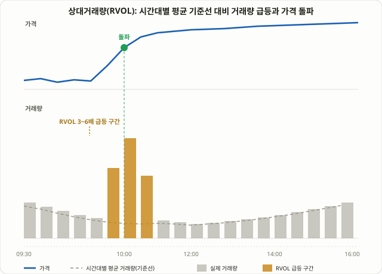

## 거래량 100만 주, 많은 걸까 적은 걸까

어떤 종목의 거래량이 오늘 100만 주라는 숫자만 보고는 그게 많은지 적은지 판단할 수 없습니다. 평소 하루 50만 주씩 거래되는 종목이라면 100만 주는 평소의 두 배로 이례적인 관심이 몰린 신호지만, 평소 500만 주씩 거래되는 종목이라면 100만 주는 오히려 평소보다 조용한 하루입니다. **상대거래량(Relative Volume, RVOL)**은 바로 이 비교 작업을 수치 하나로 압축한 지표입니다. 현재(또는 오늘 누적) 거래량을 그 종목의 과거 평균 거래량으로 나눠서, "지금 이 종목에 평소보다 몇 배의 관심이 몰리고 있는가"를 즉시 가늠하게 해줍니다.

RVOL 자체는 새로운 발명품이 아닙니다. [90강 VSA(볼륨 스프레드 분석)](/strategies/volume-spread-analysis-vsa/)나 [124강 OBV](/strategies/on-balance-volume-obv/)처럼 거래량을 해석하는 기법들은 오래전부터 있었습니다. RVOL이 따로 다룰 가치가 있는 이유는, 이 지표들이 "거래량이 늘었는지 줄었는지"를 보는 반면 RVOL은 **여러 종목을 동시에, 같은 기준으로 비교해 스캐너로 걸러낼 수 있는 표준화된 숫자**를 만들어낸다는 점입니다. 수백~수천 개 종목을 실시간으로 훑어보는 데이트레이더에게는 이 표준화 자체가 핵심 가치입니다.

## 왜 거래량 자체보다 "시간대별 평균 대비 몇 배"가 중요한가

하루 중 거래량은 균등하게 분포하지 않습니다. 미국 주식시장을 예로 들면, 장이 열리는 오전 9시 30분 직후 거래량이 가장 크게 몰리고, 점심 무렵인 정오~오후 1시경 가장 한산해지다가, 마감이 가까워지는 오후 3~4시에 다시 거래량이 솟아오르는 **U자형 패턴**이 거의 매일 반복됩니다. 이 패턴은 미국 시장뿐 아니라 한국 코스피·코스닥을 포함한 대부분의 시장에서 정도의 차이만 있을 뿐 공통적으로 나타납니다.

이 패턴을 무시하고 "오늘 오전 10시 누적 거래량이 평소 하루 평균 거래량의 20%"라는 식으로 단순 비교하면 왜곡이 생깁니다. 정상적인 날에도 하루 중 가장 거래량이 몰리는 시간대인 개장 직후라면 하루 평균의 20~30%가 오전 10시 전에 이미 체결되는 것이 자연스럽기 때문입니다. 그래서 RVOL을 제대로 쓰려면 "하루 전체 평균"이 아니라 **같은 시각(예: 매일 오전 10시) 기준의 과거 평균과 비교**해야 왜곡 없이 "평소보다 많다/적다"를 판단할 수 있습니다. 이렇게 시각을 맞춰 비교하는 방식을 RVOL-TOD(Time of Day)라고 부르는 플랫폼도 있습니다.

## RVOL 계산법: 공식과 숫자로 보는 예시

가장 단순한 형태의 공식은 다음과 같습니다.

```
RVOL = 현재(오늘) 거래량 ÷ 같은 기간의 과거 평균 거래량
```

데이트레이딩에서 실전적으로 쓰이는 형태는 "같은 시각 기준"으로 바꾼 것입니다.

```
시간대별 RVOL = 오늘 장 시작부터 현재 시각까지의 누적 거래량
              ÷ 지난 N일(보통 10~20일) 동안 같은 시각까지의 평균 누적 거래량
```

아래는 개념 이해를 위한 단순화된 가상 예시이며, 실제 특정 종목의 검증된 기록이 아닙니다.

| 시각(장 시작 후 경과) | 지난 20일 평균 누적 거래량 | 오늘 누적 거래량 | RVOL |
|---|---|---|---|
| 09:30 (0분) | 18만 주 | 20만 주 | 1.1배 |
| 09:45 (15분) | 42만 주 | 95만 주 | 2.3배 |
| 10:00 (30분) | 58만 주 | 210만 주 | 3.6배 |
| 10:30 (60분) | 85만 주 | 340만 주 | 4.0배 |

이 가상 예시에서 눈여겨볼 점은 숫자 하나가 아니라 **흐름**입니다. 09:30에는 RVOL이 1.1배로 평범했지만, 15분 사이 2.3배로 뛰고 다시 30분 만에 3.6배까지 올라가는 가속 구간이 나타납니다. 이 구간에서 가격이 동시에 뚜렷한 방향으로 움직이고 있었다면, "이 종목에 평소와 다른 수급이 실제로 몰리고 있다"는 근거로 해석하는 경우가 많습니다. 반대로 RVOL이 1배 안팎에 머물러 있다면, 차트에 그려지는 가격 움직임이 작은 물량만으로 만들어진 노이즈일 가능성을 의심해봐야 합니다.

## 전체 거래일 평균 RVOL vs 시간대별 RVOL(RVOL-TOD)

RVOL을 계산하는 방식은 크게 두 갈래로 나뉘고, 용도가 다릅니다.

| 구분 | 전체 거래일 평균 대비 RVOL | 시간대별 RVOL(RVOL-TOD) |
|---|---|---|
| 비교 기준 | 오늘 하루 전체(또는 특정 시점까지) 거래량 ÷ 과거 N일의 하루 전체 평균 거래량 | 오늘 같은 시각까지의 누적 거래량 ÷ 과거 N일의 같은 시각까지 평균 누적 거래량 |
| 장중 왜곡 | 큼 — 개장 직후처럼 원래 거래량이 몰리는 시간대에는 항상 과대평가됨 | 작음 — 같은 시각끼리 비교하므로 U자형 패턴의 영향을 제거 |
| 주로 쓰이는 용도 | 장 마감 후 스윙·중기 스캐닝, 전일 대비 관심도 비교 | 장중 실시간 데이트레이딩 스캐너, 돌파 신뢰도 확인 |
| 필요한 데이터 | 일별 거래량만 있으면 계산 가능 | 과거 N일의 분(틱) 단위 거래량 누적 데이터 필요 — 일반 무료 차트에는 기본 제공되지 않는 경우가 많음 |

장중 매매에서 전체 거래일 평균 방식을 그대로 쓰면, 장 초반에는 항상 숫자가 높게 나오고 점심 무렵에는 항상 낮게 나오는 체계적 오차가 생깁니다. 반대로 며칠 단위로 관심 종목을 추려내는 스윙 스캐닝 단계에서는 시간대별 데이터 없이도 전체 거래일 평균 방식으로 충분한 경우가 많습니다. 두 방식 중 하나가 항상 우월한 것이 아니라, 매매 시간축에 맞는 쪽을 고르는 것이 중요합니다.

## 실전 스캐너 설정: 관행적으로 쓰이는 기준점들

아래 수치들은 여러 트레이딩 교육 콘텐츠·스캐너 제공업체에서 공통적으로 언급되는 **관행적 기준**이며, 모든 시장·종목에 보편적으로 검증된 절대 법칙이 아닙니다. 실제 적용 전 자신의 매매 스타일과 대상 시장에 맞게 조정하고 백테스트해야 합니다.

| RVOL 구간 | 흔히 쓰이는 해석 |
|---|---|
| 1배 안팎 | 평소와 비슷한 수준의 거래, 특별한 관심 신호 없음 |
| 2배 이상 | 평소보다 뚜렷하게 관심이 몰린 상태 — 다수의 스캐너가 이 지점을 "주시 대상" 편입 기준으로 사용 |
| 5배 이상 | 매우 이례적인 관심 — 다만 일부 트레이더는 이 구간을 "이미 과열돼 뒤늦게 뛰어들기에는 늦었다"는 신호로도 해석 |

여기에 더해 가격·유동성 필터를 함께 거는 것이 일반적입니다. 예를 들어 "주가 5달러 이상, 평균 거래량 100만 주 이상, RVOL 2배 이상"처럼 여러 조건을 동시에 만족하는 종목만 추려내는 방식입니다. [32강 갭 앤 고](/strategies/gap-and-go-float-rotation/)에서 다룬 플로트 로테이션도 결국 "평소보다 손바뀜이 얼마나 빨리 일어나는가"를 보는 지표라는 점에서 RVOL과 사촌 관계에 있지만, 플로트 로테이션은 유동주식수라는 공급 측 변수를 분모로 쓰고 RVOL은 과거 거래량 자체를 분모로 쓴다는 차이가 있습니다.

## 방향성과 결합하기: RVOL은 "관심"을, 가격은 "방향"을 말한다

RVOL에서 가장 자주 지적되는 한계는 이 지표 자체가 매수와 매도 중 어느 쪽이 그 거래량을 만들었는지는 전혀 말해주지 않는다는 점입니다. RVOL 5배가 터진 종목이 급등 중일 수도 있고, 급락 중일 수도 있습니다. 그래서 실전에서는 RVOL을 항상 가격 움직임과 함께 읽습니다.

- **RVOL 급증 + 가격 상승**: 새로운 매수세가 유입되며 가격을 밀어 올리는 전형적인 모습으로 해석되는 경우가 많습니다. [11강 오프닝 레인지 돌파(ORB)](/strategies/breakout-donchian-orb/)나 갭 앤 고 셋업에서 "진짜 돌파"와 "거짓 돌파"를 가르는 보조 확인 장치로 RVOL이 흔히 쓰입니다.
- **RVOL 급증 + 가격 하락**: 매도 물량이 쏟아지거나, 기존 보유자들의 투매·분산이 진행 중인 신호로 해석되는 경우가 많습니다.
- **RVOL 급증 + 가격 거의 변동 없음**: 매수와 매도가 비슷한 규모로 맞붙고 있다는 뜻으로, 큰 방향 결정이 임박한 변곡점일 가능성이 있다고 보는 시각도 있습니다.

즉 RVOL 혼자서는 매매 신호가 되지 않으며, 가격 패턴·지지저항·캔들 형태 같은 다른 근거와 겹쳐야 비로소 의미가 생긴다는 점을 분명히 해둘 필요가 있습니다.

## 두 가지 해석: RVOL 돌파 추종 vs RVOL 과열 페이드

같은 "RVOL이 평소보다 매우 높다"는 관찰에서도, 트레이더들은 서로 반대되는 두 가지 전략을 끌어냅니다.

| 구분 | RVOL 돌파 추종 | RVOL 과열 페이드 |
|---|---|---|
| 핵심 가정 | 평소보다 몇 배 큰 거래량이 터졌다는 것은 새로운 정보·수급이 유입됐다는 뜻이고, 이 흐름은 당일 중 더 이어질 가능성이 높다 | RVOL이 극단적으로(예: 5~10배 이상) 치솟은 지점은 이미 대부분의 매수 동력이 소진된 "클라이맥스" 구간일 가능성이 있다 |
| 진입 시점 | RVOL이 임계값(예: 2배)을 넘어서는 초반, 가격이 같은 방향으로 움직이기 시작하는 지점 | RVOL이 극단적으로 치솟은 뒤 가격 상승 속도가 둔화되는 지점, 반대 방향 베팅 |
| 근거 | 새로운 참여자의 유입은 하루 안에 바로 소진되지 않는 경향이 있다는 경험적 관찰 | 거래량이 극단적으로 몰리는 구간은 그만큼 반대매매(차익실현·공매도 손절)도 몰려 있어 변동성이 양방향으로 커진다 |
| 주된 리스크 | 거짓 돌파에 뒤늦게 진입해 되돌림을 맞는 위험 | 생각보다 추세가 훨씬 더 이어지며 반대 방향 베팅이 손실로 이어지는 위험 |

둘 중 어느 쪽이 항상 옳다고 할 수 없습니다. 중요한 것은 RVOL의 절대 수치 하나가 아니라 **그 수치가 상승하는 중인지, 이미 정점을 찍고 꺾이는 중인지**를 함께 보는 것입니다. 거래량이 계속 커지는 가속 구간이라면 돌파 추종의 근거가 조금 더 힘을 얻고, 거래량이 극단치를 찍은 뒤 오히려 줄어들면서 가격 상승 속도도 둔화된다면 과열 페이드 쪽 해석이 힘을 얻습니다.

<figure class="diagram">
  
  <figcaption>점선으로 표시된 U자형 평균 거래량 기준선 대비, 오전 10시경 실제 거래량(막대)이 크게 치솟아 RVOL이 3배를 넘어서는 구간에서 가격도 함께 돌파하고 있다. 같은 시각 기준으로 비교해야 개장 직후의 자연스러운 거래량 증가와 진짜 이례적인 수급 유입을 구분할 수 있다.</figcaption>
</figure>

## 한계와 주의할 점

- **방향을 말해주지 않는다**: 앞서 설명했듯 RVOL은 "관심의 크기"만 알려주며, 반드시 가격 움직임과 함께 해석해야 합니다.
- **플랫폼마다 계산 방식이 다르다**: 평균을 10일로 잡는 곳도 있고 20일·30일로 잡는 곳도 있으며, 시간대별 보정을 제공하는 곳과 전체 거래일 평균만 제공하는 곳이 섞여 있습니다. 같은 "RVOL 2배"라는 숫자도 플랫폼에 따라 전제가 다를 수 있습니다.
- **저유동성 종목에서는 왜곡이 커진다**: 평소 거래량 자체가 매우 적은 종목은 소액 주문 몇 건만으로도 RVOL이 비정상적으로 치솟을 수 있어, 평균 거래량이 어느 수준 이상인 종목에만 RVOL 스캔을 적용하는 것이 안전합니다.
- **검증된 단일 승률은 없다**: "RVOL 2배 이상 돌파 추종 전략의 승률 OO%"처럼 구체적 수치를 내세우는 콘텐츠를 만날 수 있지만, 공개적으로 검증된 범용 수치는 없습니다. [85강 워크포워드 분석](/strategies/walk-forward-analysis-overfitting/)에서 다룬 과최적화 함정을 항상 염두에 두고, 자신의 매매 대상·시간대에서 직접 검증하는 과정이 필요합니다.
- **뉴스·공시 확인이 선행돼야 한다**: RVOL 급증 뒤에는 대개 구체적인 촉매(실적, 공시, 루머)가 있습니다. 촉매 없이 거래량만 튀는 경우는 호가 오류나 다른 티커와의 혼동일 가능성도 있으므로, 반드시 뉴스 확인을 병행해야 합니다.

## 자주 묻는 질문

### RVOL이 높으면 무조건 매수해도 되나요?

아닙니다. RVOL은 평소보다 관심이 몰렸다는 사실만 알려줄 뿐, 그 관심이 매수 쪽인지 매도 쪽인지는 가격 움직임을 함께 봐야 판단할 수 있습니다. 또한 RVOL이 극단적으로 높은 구간은 이미 과열된 클라이맥스일 가능성도 있어, 단순히 "RVOL이 높다"는 이유만으로 뒤늦게 추격 매수하는 것은 위험합니다.

### RVOL은 어디서 확인할 수 있나요?

대부분의 실시간 시세 플랫폼과 데이트레이딩 전용 스캐너가 RVOL 또는 이와 유사한 이름의 지표를 기본 제공합니다. 다만 시간대별 보정(RVOL-TOD)까지 제공하는지는 플랫폼마다 다르므로, 전체 거래일 평균만 제공하는 도구를 장중 매매에 쓸 때는 개장 직후·마감 직전 숫자가 항상 높게 나온다는 점을 감안해서 읽어야 합니다.

### RVOL과 OBV·VSA 같은 다른 거래량 지표는 어떻게 다른가요?

[124강 OBV](/strategies/on-balance-volume-obv/)나 [90강 VSA](/strategies/volume-spread-analysis-vsa/)는 거래량과 가격 변화의 관계를 해석해 추세의 질이나 매집·분산 여부를 판단하는 데 초점을 둡니다. 반면 RVOL은 해석보다 **스캐닝과 비교**에 특화된 지표로, "지금 이 순간 수백 개 종목 중 어떤 종목이 평소와 다른 거래량을 보이는가"를 빠르게 걸러내는 1차 필터 역할을 합니다. 이렇게 걸러낸 종목을 OBV·VSA 같은 지표로 다시 들여다보는 식으로 함께 쓰는 경우가 많습니다.

## 정리

- 상대거래량(RVOL)은 현재(또는 오늘 누적) 거래량을 과거 평균 거래량과 비교해 "평소보다 몇 배의 관심이 몰렸는가"를 나타내는 표준화된 지표입니다.
- 거래량은 하루 중 U자형으로 분포하므로, 전체 거래일 평균보다 같은 시각 기준으로 비교하는 시간대별 RVOL(RVOL-TOD)이 장중 매매에서는 왜곡을 줄여줍니다.
- RVOL 2배 이상을 "주시 대상" 기준으로 쓰는 관행이 흔하지만, 이는 검증된 절대 법칙이 아니라 여러 콘텐츠에서 공통적으로 언급되는 경험칙일 뿐입니다.
- RVOL은 방향을 말해주지 않으므로 가격 움직임·지지저항과 함께 읽어야 하며, 같은 "RVOL 급증"도 돌파 추종과 과열 페이드라는 정반대 해석으로 이어질 수 있습니다.
- 저유동성 종목의 왜곡, 플랫폼별 계산 방식 차이, 검증되지 않은 승률 주장을 항상 경계하고, [32강 갭 앤 고](/strategies/gap-and-go-float-rotation/)·[11강 ORB](/strategies/breakout-donchian-orb/) 같은 다른 확인 장치와 함께 쓰는 것이 바람직합니다.
